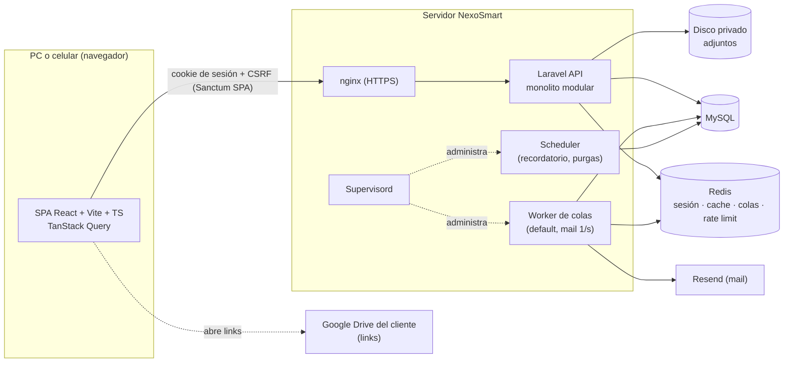
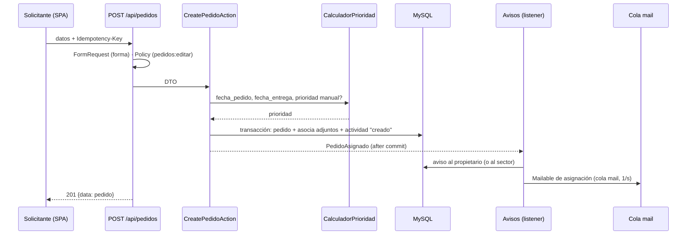
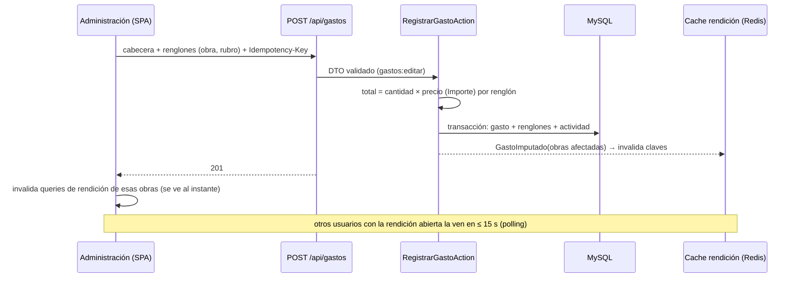

# Arquitectura — Etapa 1

> Rol: CTO / Arquitecto. Estado: **Propuesta para aprobar por Juani** (Sprint 0, 2026-11-12).
> Contrato: documento firmado (`tecnoservicios/docs/entregas/2026-10-19-documento-sdr/`).
> Decisiones: [`adr/`](adr/README.md). Datos: [`modelo-datos.md`](modelo-datos.md).

## 1. Vista general



- **Un solo backend**, una sola base. ≈13 usuarios: la complejidad se gasta en reglas
  correctas, no en infraestructura (ADR-002, ADR-003).
- **Archivo o link**: donde hay un documento (pedido, comprobante, presupuesto, OC, certificado, factura, remito) se sube el archivo o se pega el link (ADR-014, amplía D-022). Los archivos van a disco privado y se descargan solo con permiso sobre el recurso dueño.
- **Tiempo real** con polling corto + invalidación (ADR-005).
- **Sin integraciones externas** salvo el envío de mail.

## 2. Módulos del backend

| Módulo | Capítulo / F-XX | Dueño de las tablas | Publica (eventos / contratos) |
|---|---|---|---|
| **Identidad** | cap. 11 · F-01, F-02, F-10, F-58…F-61, F-68 | users, sectores, funciones, permisos, plazos_prioridad | `PermisoService`, `JerarquiaService` (mi gente, superior), `PlazosPrioridad` |
| **Obras** | cap. 6 · F-15…F-23 | obras, presupuestos, obra_contactos, obra_documentos | `ObraEstadoCambiado`, `PresupuestoAgregado`; `ObrasQuery` (buscador) |
| **Pedidos** | cap. 7 · F-24…F-38, F-65, F-67 | pedidos, pedido_comentarios, pedido_seguidores, equipos_reparacion | `PedidoAsignado`, `PedidoReasignado`, `PedidoTomado`, `PedidoBloqueado`, `PedidoComentado`, `PedidoCompletado`, `PedidoReabierto`; `PedidosAbiertosDeObra` |
| **Gastos** | cap. 8 · F-39…F-47 | gastos, gasto_renglones | `GastoImputado`, `GastoCorregido`, `GastoAnulado` |
| **Rendicion** | cap. 9 · F-48…F-54, F-66 | rubros, presupuesto_montos, materiales | `RendicionDeObraQuery`, `RendicionesEnCursoQuery`, `RubroCatalog` |
| **Proveedores** | cap. 10 · F-55…F-57 | proveedores | `ProveedorLookup` |
| **Avisos** | F-07, F-08, F-09, F-37, F-64 | avisos, preferencias_aviso | escucha los eventos de Pedidos |
| **Importacion** | cap. 12 · F-62 | (registro de corridas) | usa los casos de uso de los demás módulos; nunca escribe tablas ajenas directamente |
| **Shared** | F-14 · adjuntos (ADR-014) | actividades, idempotency_keys, adjuntos | `RegistroActividad`, `AdjuntosService`, middleware `Idempotent`, envelope JSON, value objects |

**Regla de límites:** un módulo escribe solo sus tablas. Para lo ajeno usa el `Contracts/`
del otro módulo o reacciona a sus eventos. Leer por FK con Eloquent está permitido.
El test de arquitectura lo hace cumplir (ADR-003).

### Capas dentro de cada módulo

```
app/Modules/Pedidos/
├── Http/            Controllers delgados, FormRequests (validan forma y tipos en el borde),
│                    Resources (salida), Policies (leen PermisoService), routes.php
├── Application/     Un caso de uso por clase: CreatePedidoAction, TomarPedidoAction,
│                    CompletarPedidoAction… DTOs de entrada/salida. Abre la transacción,
│                    registra la actividad, dispara eventos después del commit.
├── Domain/          Models (Eloquent), Enums de estado, PedidoStateMachine, estrategias
│                    de prioridad, Value Objects, Events. Reglas puras sin framework.
├── Infrastructure/  Queries complejas (filtros componibles), listeners técnicos, mail.
├── Contracts/       Interfaces públicas para otros módulos.
└── README.md        Propósito, F-XX que cubre, reglas → docs/especificacion/pedidos.md
```

## 3. Patrones (dónde y por qué)

| Patrón | Dónde | Qué resuelve |
|---|---|---|
| **State** | `PedidoStateMachine`, `ObraStateMachine` | Las transiciones válidas viven en un solo lugar (tabla de transiciones + guardas). Completar exige comentario (D-030); bloquear exige motivo; reabrir solo desde completada; Terminada lista pedidos abiertos antes de confirmar |
| **Strategy** | `CalculadorPrioridad` (`PorAnticipacion` con plazos de W-50, `Manual`) | F-26: se calcula sola y se puede corregir; los plazos se configuran sin tocar código |
| **Policy/Gate sobre matriz** | `PermisoService` + Policies por recurso | D-037/F-60: ningún rol en el código; nivel `ver/editar` y alcance `todas/propias` (ADR-006) |
| **Eventos de dominio + listeners** | Pedidos → Avisos; Gastos → Rendicion (invalidación de cache) | Desacopla módulos; avisos y recálculo sin condicionales en los casos de uso |
| **Query object / filtros componibles** | `PedidosQuery`, `ObrasQuery`, `GastosQuery` | F-35, F-45, F-03: cada filtro es una clase chica que se suma (`PorObra`, `PorEstado`, `Vencidos`…) |
| **Read model calculado** | `RendicionDeObraQuery` con cache por obra | RN-07 sin doble conteo (ADR-007) |
| **Value Object** | `Importe`, `Cantidad`, `NumeroPresupuesto`, `RangoFechas` | ADR-008 |
| **Repository** | Solo en Importacion (lectores de xlsx) | No se envuelve Eloquent sin motivo |

## 4. Flujos clave

### 4.1 Crear un pedido y avisar (F-24, F-26, F-09)



### 4.2 Completar un pedido (F-31, D-030)
`POST /api/pedidos/{id}/completar` con `comentario` (obligatorio) y comprobantes
(opcionales: ids de adjuntos ya subidos, archivo o link) → Policy: solo el propietario → `PedidoStateMachine` valida `en_curso|bloqueada → completada`
(y `no_iniciada → completada` si el documento lo admite, ver especificación) → guarda cierre +
actividad → `PedidoCompletado` → avisos al solicitante, a su superior (`jefe_id`) y a los
seguidores, dentro del sistema.

### 4.3 Cargar una factura y ver la rendición (F-39, F-40, F-49)



### 4.4 Recordatorio de entrega (F-37)
Scheduler (Supervisord) cada hora → `avisos:recordatorios` → pedidos abiertos con
`fecha_entrega = mañana` → aviso `vence_manana` con `dedupe_key` (no se repite) → solo en el
sistema.

### 4.5 Pasar una obra a Terminada (F-21, W-22)
`GET /api/obras/{id}/pedidos-abiertos` (contrato de Pedidos) → la ventana los muestra para
completarlos o reasignarlos → `POST /api/obras/{id}/estado` → `ObraStateMachine` → actividad →
`ObraEstadoCambiado`.

## 5. API

- REST JSON bajo `/api/`, envelope `{ data, message, errors }` en todas las respuestas;
  listados paginados (25 por defecto) con `meta` y `links` dentro de `data`.
- Códigos: 200/201, 401 sin sesión, 403 sin permiso, 404 (también para recursos que existen
  pero no se pueden ver con alcance `propias`: no se filtra su existencia), 409 transición
  inválida, 422 validación (errores por campo), 429 throttle.
- `GET /api/me` devuelve usuario, sector, jefe y la matriz de permisos efectiva: el front arma
  el menú (F-02) y los guards con eso, y el backend vuelve a controlar en cada endpoint.
- Importes como string decimal (ADR-008). Fechas `YYYY-MM-DD`; timestamps ISO-8601 con zona
  `America/Argentina/Buenos_Aires`.

## 6. Frontend

```
src/
├── app/        router, providers (QueryClient), guard de sesión, guard por permiso, layout raíz
├── features/   identidad · obras · pedidos · gastos · rendicion · proveedores · avisos
│   └── <modulo>/  pages/ components/ hooks/ api/ types.ts schemas.ts __tests__/
└── shared/     ui/ (componentes base + tokens), layout/ (barra superior, barra inferior celular),
                api/ (cliente fetch Sanctum + envelope + ApiError), forms/, tables/, format/
```

- La barra única de las maquetas (Inicio · Pedidos · Obras · Calendario · Gastos ·
  Rendiciones · Proveedores · Usuarios) se filtra con los permisos de `/api/me`. En celular,
  barra inferior Tareas · Obras · Avisos · Más (W-41).
- Cada pantalla resuelve carga, vacío, error y sin permiso, y se verifica contra su W-XX.
- El front valida **forma** con zod (mismos límites que el FormRequest); **las reglas de
  negocio las decide el backend** y el front muestra sus 422/409.

## 7. Seguridad (detalle en `seguridad.md`, semana 1)

- Sanctum SPA, CSRF, cookies `Secure`/`HttpOnly`/`SameSite=Lax`, HTTPS forzado.
- Autorización en **cada** endpoint por Policy + matriz; tests de IDOR.
- Sin `X-Powered-By` ni `Server`; la raíz devuelve `{"status":"ok"}`; errores 500 sin detalle.
- Throttle en login, recuperación y API general; logs sin datos personales ni importes.
- Adjuntos: tipo validado por contenido, 20 MB máx., sin ejecutables/HTML/SVG, disco privado, descarga autorizada por la Policy del dueño con `attachment` + `nosniff`.
- `.env` y `.claude/bug-report.json` fuera del repo; `/api/errors` protegido por token.

## 8. Operación

- Entornos: local (Laragon: MySQL + Redis), staging y producción en servidor de NexoSmart.
- Supervisord: `queue:work` (colas `default` y `mail`), `schedule:work`; se generan con
  `php artisan supervisor:sync` (nunca crontab).
- Infra `/bug-report`: `/api/health` y `/api/errors` con canal de logs `errors`.
- Backups diarios de MySQL con retención (detalle en `deploy.md`).
- CI en cada PR: lint, tipos, tests (ADR-013).

## 9. Qué queda abierto para Juani

Aprobados por Juani el 2026-11-12: polling (ADR-005), alcance "solo sus obras" (ADR-006) y adjuntos archivo o link (ADR-014). Pendiente: el servidor de staging/producción para `deploy.md`.
