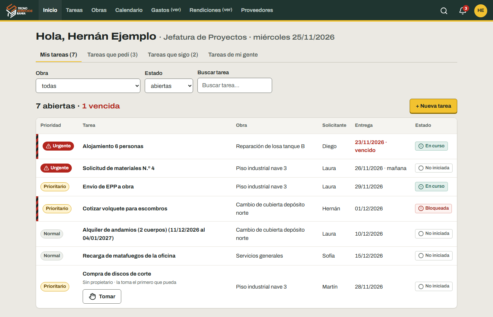
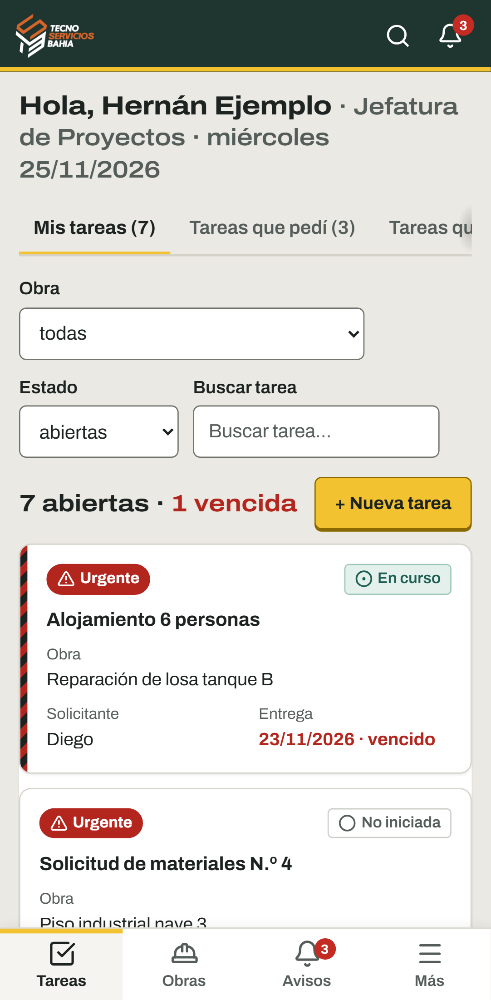
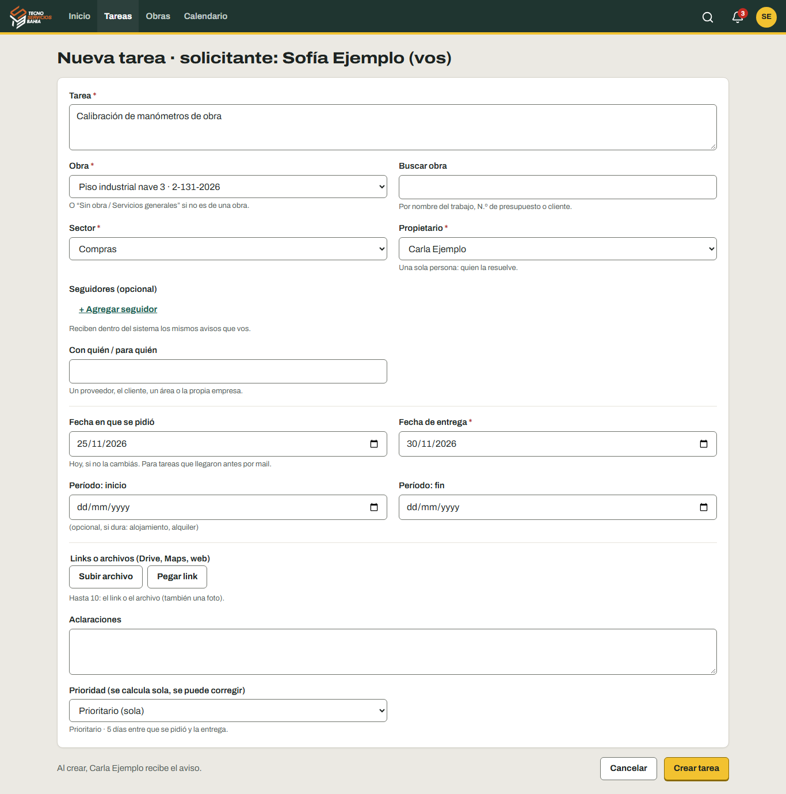
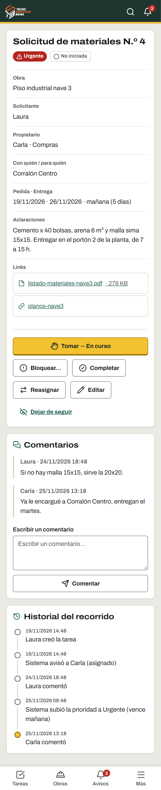
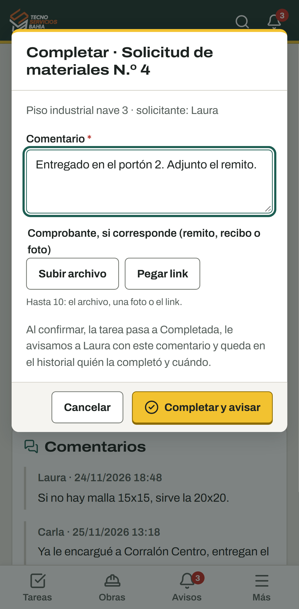

# Tu primer día · Ingeniería de proyectos

Desde hoy las tareas se piden, se siguen y se cierran en el sistema, y la rendición de tus obras está al día. Esto es lo que necesitás para el primer día.

## Tu primer día

### 1. Qué ves al entrar

Entrás con tu mail y el código de 6 números que te llega, como en las pruebas. Arriba dice
**"Hola, {tu nombre} · Ingeniería de proyectos"** y abajo, **Mis tareas**: lo que tenés que hacer vos, de todas las obras juntas, con
lo vencido y lo urgente arriba.

- **En la computadora**, la barra de arriba: **Inicio · Tareas · Obras · Calendario · Gastos (ver) · Rendiciones (ver)**.
- **En el celular**, la barra de abajo: **Tareas · Obras · Avisos · Más**.
- Al lado de **Mis tareas**: **Tareas que pedí** (lo que le pediste a otros) y **Tareas que sigo**.
- La **campana** cuenta lo nuevo.

| Computadora | Celular |
|---|---|
|  |  |

### 2. Tus tareas de la minuta ya están acá

Las tareas abiertas de la minuta ya están cargadas, con quién la tiene (una persona o el sector) y su fecha de
entrega. Las ves en **Mis tareas** como cualquier otra.

- **No te avisaron al cargarlas:** ni la campana ni un mail. Por eso, el primer día entrá a mirarlas.
- **En el detalle tienen la marca "Carga inicial"**: "Vino de la minuta al arrancar el sistema."
- Si la minuta no decía quién la pidió o cuándo, vas a ver **"Solicitante: —"** y **"Pedida: —"**.
- Desde ahora funcionan como cualquier tarea: el recordatorio del día anterior a la entrega llega igual.

La minuta queda **de consulta**: lo nuevo se carga acá.

### 3. Cargar una tarea

1. En **Mis tareas**, tocá **"+ Nueva tarea"**.
2. Completá **Tarea** (qué hay que hacer), **Obra** (o "Sin obra / Servicios generales"), **Sector** y
   **Propietario** (una sola persona: quien la resuelve) y la **Fecha de entrega**.
3. Si hace falta, sumá **Aclaraciones** y **"Links o archivos (Drive, Maps, web)"** con **Subir archivo** o
   **Pegar link**.
4. Tocá **"Crear tarea"**. Abajo te dice a quién le llega el aviso.

La **prioridad se calcula sola** con la fecha en que se pidió y la de entrega; se puede cambiar a mano.

### 4. Tomarla y completarla

1. Tocá la tarea en **Mis tareas** para abrirla.
2. **"Tomar → En curso"**: avisás que la estás haciendo. Si dice **"Sin propietario · la toma el primero que
   pueda"**, es de tu sector: el que toca **"Tomar"** primero se la queda.
3. Cuando está hecha, **"Completar"**: escribí un **Comentario** (es obligatorio) y, si corresponde, el
   comprobante (remito, recibo o foto). En el celular podés sacarle la foto al remito.
4. **"Completar y avisar"**: la tarea pasa a Completada y le avisa a quien la pidió.

Si algo te frena, **"Bloquear…"** y contá qué falta. Si no es tuya, **"Reasignar"**.

| Abrir y tomar | Completar con el comprobante |
|---|---|
|  |  |

### Mirar gastos y rendiciones

Con **"(ver)"** en la barra podés mirar sin tocar las **obras donde sos responsable**: **Rendiciones** muestra las
**"Rendiciones en curso"** y, tocando una obra, su rendición por rubro al día (lo pasado, en rojo). **Gastos**
muestra lo cargado en esas obras.

### Si algo no se entiende

Cualquier cosa que no se entienda, que te resulte más lenta que la minuta o que no funcione, contanos por Discord
con una captura. En la primera semana estamos con ustedes.
