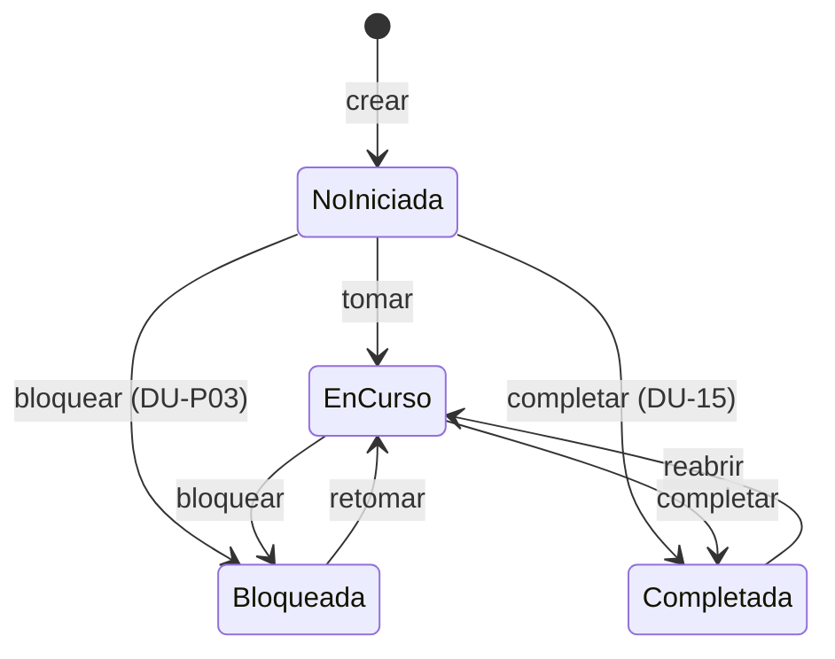

# Especificación funcional · Pedidos (la minuta) y equipos en reparación

> Módulo `app/Modules/Pedidos` · Entrega: **semana 2** · Rol: Analista funcional · 2026-11-16
> Contrato: documento firmado v1.1 (cap. 3, 4.2, 4.5, 5, 7, 11, 13) + maquetas W-01, W-03, W-04, W-07 (pestaña
> Pedidos), W-08, W-09, W-22 (lista de pedidos abiertos), W-24…W-32, W-41, W-42, W-43, W-47 (parte pedidos), W-49.
> Material real: análisis de la minuta (piso funcional, D-007). Decisiones: D-016, D-018…D-023, D-030…D-032,
> D-038. ADR-003 (puertos), ADR-005 (polling), ADR-006 (matriz y alcance), ADR-010 (recorrido), ADR-011
> (idempotencia), ADR-012 (avisos), **ADR-014** (archivo o link), **ADR-015** (ingreso por código).
> Los avisos (quién recibe qué, campana, mail, recordatorio) están en [`avisos.md`](avisos.md); acá solo se dice
> **qué evento** dispara cada acción.
> Lo "Propuesto" del documento está **aprobado**. Las dudas de semana 2 del Sprint 0 están **resueltas**
> (DU-12, DU-13 con el texto firmado, DU-14, DU-15, DU-16, DU-22, DU-A13, DU-A15, DU-20): las reglas que dependen
> de ellas son definitivas y citan "resuelta DU-XX". Lo nuevo está en `docs/dudas.md` como **DU-P01…DU-P24** (esta especificación) y **DU-Q01…DU-Q03** (PO + QA, lo
> que DU-P no cubre). **19-nov-2026: Juani las resolvió todas (va la propuesta)**: las reglas que dependían de ellas son definitivas y citan "resuelta DU-PXX" o "resuelta DU-QXX".
> Personas, obras, proveedores y textos de este archivo son **ficticios** (los de las maquetas).

## 1. Propósito

"No darles menos de lo que ya tienen" (D-007): todo lo que hoy hace la minuta —tarea, con quién, prioridad,
propietario, solicitante, estado (4), fechas, período, varios links y notas— y además: **avisa solo, nadie pierde
un pedido, se ve desde el celular y queda registrado el recorrido** (cap. 7). Los pedidos van en los dos sentidos
(operaciones ⇄ administración, D-021). Cada persona entra y ve **sus tareas de todas las obras juntas**; las
jefaturas ven además las de su gente. Incluye la solapa "Equipos en reparación" de la minuta como lista propia.

> **Vocabulario (DU-C01, 2026-11-25):** para el usuario se dice "tarea(s)", no "pedido(s)". Los textos citados en
> esta spec ya están con la palabra nueva. El módulo, las rutas, la API, las claves y los permisos siguen
> llamándose `pedidos`.

## 2. Funcionalidades y pantallas cubiertas

| F-XX | Qué | Pantalla | Semana 2 |
|---|---|---|---|
| F-04 | Mis tareas: pedidos de los que soy propietario, abiertos, por entrega, con prioridad y vencidos marcados. Pantalla de inicio | W-01 · W-41 | completa |
| F-05 | Pedidos que pedí | W-27 | completa |
| F-06 | Tareas de mi gente, agrupadas por persona | W-26 | completa |
| F-07 | Tareas que sigo (seguir / dejar de seguir; los avisos al seguidor en `avisos.md`) | W-28 · W-08 · W-09 | completa |
| F-11 | Calendario: entregas por día, períodos como barra, vista mes y semana, filtro por obra y "Mi gente" | W-03 | completa |
| F-12 | Carga por persona: abiertas, vencidas y para esta semana | W-04 | completa |
| F-13 | Celular: Mis tareas, detalle y completar, nuevo pedido, obras con sus pedidos | W-41 · W-42 · W-43 · W-47 | completa (W-44, rendición, es semana 3) |
| F-24 | Crear un pedido | W-08 · W-43 | completa |
| F-25 | Fecha de pedido automática y corregible | W-08 | completa |
| F-26 | Prioridad automática y corrección manual | W-08 · W-32 | completa |
| F-27 | Varios links por pedido (**archivo o link**, ADR-014) | W-08 · W-43 | completa |
| F-28 | Tomar → En curso | W-09 | completa |
| F-29 | Bloquear con motivo (y Retomar) | W-30 | completa |
| F-30 | Comentarios con autor y fecha | W-09 · W-42 | completa |
| F-31 | Completar con comentario y comprobantes (archivo o link) | W-29 · W-42 | completa |
| F-32 | Reasignar a otra persona o dejarlo en el sector | W-31 | completa |
| F-33 | Editar con registro del cambio | W-32 | completa |
| F-34 | Recorrido del pedido | W-09 | completa |
| F-35 | Todos los pedidos, con filtros y exportar a Excel | W-24 | completa |
| F-36 | Pedidos sin obra (Servicios generales) | W-25 | completa |
| F-38 | Un propietario por pedido (persona y su sector) + seguidores | W-08 | completa |
| F-65 | Reabrir un pedido completado | W-09 | completa |
| F-67 | Equipos en reparación | W-49 | completa |
| F-37 | Recordatorio un día antes | (W-02) | regla en `avisos.md` |
| F-03 (pedidos) | Buscador general: pedidos por texto | W-18 | se suma el grupo Tareas |
| F-14 (pedidos) | Quién hizo qué y cuándo en cada pedido | W-09 · W-32 | completa |
| F-15 (pedidos) | Columna "Pedidos abiertos" y fila "Servicios generales" del listado de obras | W-05 · W-47 | contrato `PedidosDeObra` (§11.4) |
| F-17 (pedidos) | Pestaña Pedidos de la ficha de la obra | W-07 · W-47 | completa |
| F-21 (pedidos) | Pedidos abiertos al pasar la obra a Terminada | W-22 | contrato `PedidosDeObra` |
| F-61 | Visibilidad por jerarquía y alcance "propias" | W-01 · W-26 | completa |
| F-68 (aplicar) | La prioridad de cada pedido nuevo usa los plazos de W-50 | W-08 | completa |

Se encienden en la barra (lista de módulos habilitados de DU-A12) **Tareas** y **Calendario**, e **Inicio** pasa
a abrir Mis tareas (HU-024 abría Obras en semana 1).

## 3. Glosario (palabras del cliente → código)

| Cliente | Código | Qué es |
|---|---|---|
| Pedido / tarea | `Pedido` / `pedidos` | Una fila de la minuta. "Tarea" es el texto libre del pedido; "Mis tareas" son los pedidos de los que soy propietario. |
| Solicitante / "el que lo pidió" | `solicitante_id` | Quien lo cargó (automático). |
| Propietario | `propietario_id` | La persona que lo resuelve. Uno solo por pedido (F-38). Vacío = "en el sector". |
| Sector | `sector_id` | El sector del propietario; si no hay persona, el pedido "queda en su sector" (cap. 4.2). |
| En el sector / sin propietario | `propietario_id = null` | Lo toma el primero que pueda del sector (resuelta DU-16). |
| Seguidor | `pedido_seguidores` | Alguien que no lo pidió ni lo resuelve pero quiere enterarse (F-07). |
| Con quién / para quién | `con_quien` | La columna PROVEEDOR de la minuta: proveedor, cliente, área, la propia empresa, una persona. Texto libre; **no** es el maestro de proveedores. |
| Fecha de pedido · fecha de entrega | `fecha_pedido`, `fecha_entrega` | Cuándo se pidió · cuándo lo necesita quien pide ("la fecha comprometida"). |
| Período | `periodo_inicio`, `periodo_fin` | Lo que dura: alojamiento, alquiler, obrador. |
| Links | adjuntos contexto `pedido` | Drive, Maps, la página de un producto… o el archivo subido (ADR-014). |
| Aclaraciones | `aclaraciones` | Lo que hoy va en "Notas" al cargar. La ida y vuelta posterior son **comentarios**. |
| Prioridad | `Prioridad`: `urgente` · `prioritario` · `normal` | Calculada por anticipación (W-50) y corregible. |
| Estado | `PedidoEstado`: `no_iniciada` · `en_curso` · `bloqueada` · `completada` | Los cuatro de su desplegable. |
| Abierto | — | No iniciada, En curso o Bloqueada. |
| Vencido | — | Abierto con la entrega antes de hoy. |
| Motivo de bloqueo | `motivo_bloqueo` | Obligatorio al bloquear ("esperando presupuesto"). |
| Comentario de cierre · comprobante | `comentario_cierre` + adjuntos contexto `comprobante_cierre` | La constancia de cómo se resolvió (D-030): remito, recibo, foto. |
| Recorrido | `actividades` (+ avisos enviados) | Quién lo creó, tomó, bloqueó, comentó, reasignó, completó, y cuándo (F-34). |
| Mi gente | `Jerarquia::subordinados` | Quienes dependen de mí, directa o indirectamente (RN-IDE-23). |
| Servicios generales / sin obra | `obra_id = null` | Lo que no es de una obra (F-36). |
| Equipo en reparación | `EquipoReparacion` / `equipos_reparacion` | La solapa homónima de la minuta (F-67). |
| Carga inicial | `pedidos.carga_inicial` | Pedido abierto que vino de la minuta al arrancar (F-62, resuelta DU-20). |

## 4. Datos

### 4.1 Pedido (`pedidos`) — tabla "Datos del pedido" (cap. 7), W-08, W-32

| Campo | Tipo | Oblig. | Validación | Fuente |
|---|---|---|---|---|
| tarea | texto ≤ 2000 | **Sí** | sin espacios al borde; no vacío | cap. 7 "Tarea (texto libre)" · W-08 "*" |
| obra_id | ref. obra · `null` = sin obra | **Sí elegir** (una obra **o** "Sin obra") | la obra existe, en cualquier estado (RN-PED-07) | cap. 7 "Obra (o sin obra)" · W-08 "Obra * o Sin obra" |
| sector_id | ref. sector activo | **Sí** | activo | cap. 7 "Sector" · W-08 "*" · D-032 |
| propietario_id | ref. usuario activo · `null` = en el sector | **Sí al crear** | activo y **del sector elegido** (RN-PED-03); vacío solo por "dejarlo en el sector" (W-31) | F-38 · W-08 "*" · resuelta DU-14 |
| solicitante_id | ref. usuario | automático | quien carga; no se edita. `null` solo en carga inicial (§4.6) | cap. 7 "Solicitante (quien lo carga)" |
| con_quien | texto ≤ 150 | No | libre | cap. 7 "Con quién / para quién" · W-08 |
| fecha_pedido | fecha | automática | hoy (Argentina) por defecto; corregible; no posterior a hoy (resuelta DU-P08). `null` solo en carga inicial | F-25 · W-08 |
| fecha_entrega | fecha | **Sí** | fecha válida; puede ser pasada (queda vencido) | resuelta DU-14 · W-08 "*" |
| periodo_inicio, periodo_fin | fecha · fecha | No | los dos o ninguno; fin ≥ inicio (RN-PED-05) | F-24 · W-08 "Período (opcional, si dura)" |
| adjuntos (links) | 0 a 10 adjuntos contexto `pedido`, cada uno archivo **o** link | No | `obras.md` §4.8 | F-27 · ADR-014 |
| aclaraciones | texto ≤ 5000 | No | — | cap. 7 · W-08 |
| prioridad | `urgente`·`prioritario`·`normal` | automática | calculada (RN-PED-11) o corregida (RN-PED-12) | F-26 |
| prioridad_manual | booleano | — | `true` si quien lo pidió la corrigió | F-26 · resuelta DU-A13 |
| estado | `PedidoEstado` | automático | nace `no_iniciada`; cambia solo por las acciones de §6 | cap. 7 "Estados del pedido" |
| motivo_bloqueo | texto ≤ 2000 | si `bloqueada` | no vacío | F-29 · W-30 "Motivo *" |
| comentario_cierre | texto ≤ 5000 | si `completada` | no vacío | F-31 · D-030 · W-29 "Comentario *" |
| completado_at, completado_por | fecha y hora · ref. usuario | si `completada` | — | W-29 "quién la completó y cuándo" |
| comprobantes de cierre | 0 a 10 adjuntos contexto `comprobante_cierre` | No | `obras.md` §4.8 | F-31 · W-29 "+ agregar otro link" · ADR-014 |
| carga_inicial | booleano, default `false` | — | solo lo pone la importación (semana 4) | resuelta DU-20 |
| created_at, updated_at | — | — | — | W-09 "creó la tarea" |

**Ajustes al modelo de datos** que pide esta especificación (para el DBA, decisión técnica; ver DU-P10):
`solicitante_id` y `fecha_pedido` **nullable** (solo `carga_inicial`), columna `carga_inicial`, y
`completado_por` FK a `users`. El resto como en `modelo-datos.md` (Pedidos, Planificado).

### 4.2 Comentario (`pedido_comentarios`) — F-30, W-09

| Campo | Tipo | Oblig. | Validación |
|---|---|---|---|
| pedido_id | ref. pedido (cascade) | Sí | — |
| user_id | ref. usuario | Sí | el autenticado |
| texto | texto ≤ 5000 | Sí | sin espacios al borde; no vacío |
| created_at | fecha y hora | Sí | "Carla · 14-oct 9:12" |

Solo inserción: un comentario no se edita ni se borra (F-30 "cada comentario guarda autor y fecha").

### 4.3 Seguidor (`pedido_seguidores`) — F-07, W-28

`pedido_id`, `user_id`, `created_at`; único `(pedido_id, user_id)`.

### 4.4 Equipo en reparación (`equipos_reparacion`) — F-67, W-49

| Campo | Columna de W-49 | Tipo | Oblig. | Validación / valores |
|---|---|---|---|---|
| equipo | "Equipo" | texto ≤ 150 | **Sí** (resuelta DU-P18) | "Hidrolavadora" |
| codigo | "· código" | texto ≤ 40 | No | "HL-01" (código interno; enlazará con Herramientas) |
| trabajo | "Falla o trabajo" | texto ≤ 2000 | **Sí** (resuelta DU-P18) | "Pérdida en la bomba" |
| taller | "Proveedor / taller" | texto ≤ 150 | No | texto libre, como hoy (no es el maestro de proveedores) |
| estado | "Estado" | `no_iniciada`·`para_retiro`·`en_curso`·`bloqueada`·`completada` | Sí (default `no_iniciada`) | No iniciada · Para retiro · En curso · Bloqueada · Completada |
| aprobacion | "Aprobación" | `pendiente`·`aprobado`·`bloqueado` | Sí (default `pendiente`) | Pendiente de aprobación · Aprobado · Bloqueado |
| fecha | "Fecha" | fecha | No | **cuándo se mandó al taller**; "cuándo vuelve" va en Notas (resuelta DU-Q03) |
| inventario | "Link" (inventario) | 1 adjunto contexto `equipo_inventario`: archivo o link | No | ADR-014 |
| presupuesto del taller | (no tiene columna en W-49; está en la solapa de hoy) | 1 adjunto contexto `equipo_presupuesto`: archivo o link | No | ADR-014 · análisis de la minuta §9 |
| notas | "Notas" | texto ≤ 2000 | No | — |
| created_by, updated_by, timestamps | — | — | — | — |

No lleva importes: el "valor" de la solapa de hoy no está en F-67 ni en W-49 (fuera; regla de oro).

### 4.5 Adjuntos de este módulo (ADR-014, `identidad.md` §6.6)

| Contexto | Dueño | Cantidad | Ver / bajar | Asociar / quitar |
|---|---|---|---|---|
| `pedido` | pedido | 0 a 10 | quien puede ver el pedido | quien puede editar el pedido (RN-PED-28) |
| `comprobante_cierre` | pedido | 0 a 10 por cierre | quien puede ver el pedido | asocia quien completa; quita **solo quien lo completó** (RN-PED-21) |
| `equipo_inventario`, `equipo_presupuesto` | equipo | 1 cada uno | `equipos_reparacion` ≥ ver | `equipos_reparacion` = editar |

Alias de `Relation::morphMap` (en `PedidosServiceProvider`, antes de la primera actividad): `pedido`,
`equipo_reparacion`. Las implementaciones de `AutorizaAdjuntos` se registran por contexto en `ContextosAdjuntos`.

### 4.6 Pedidos de la carga inicial (F-62, resuelta DU-20)

Los pedidos abiertos que vienen de la minuta (semana 4) entran con `carga_inicial = true` y con lo que tengan:
**solicitante** vacío si no figura (en la minuta solo el 22 % lo tiene), **fecha de pedido** vacía si no figura,
**prioridad** la de la minuta (o calculada si están las dos fechas; si no, Normal), y el estado que tenían
(Bloqueada con el texto de "Notas" como motivo). Fecha de entrega y propietario los completa el sector antes del
arranque (DU-20); **lo que no se completó no entra** y el sector lo carga a mano en W-08 (resuelta DU-I03). "(en el
sector)" vale en lugar del propietario, salvo en una En curso (`importacion.md` RN-IMP-34). La prioridad queda
**corregida a mano** solo si están las dos fechas y la de la minuta difiere de la calculada (RN-IMP-35). El detalle
muestra la marca "Carga inicial" (RN-IMP-40). Los crea `Pedidos\Contracts\CargaInicialDeTareas` (`importacion.md`
§11.4), que **no** dispara `PedidoAsignado` ni ningún aviso o mail (RN-IMP-37, resuelta DU-I05). Este módulo solo
tiene que **admitirlos** desde la semana 2 (modelo y pantallas).

## 5. Reglas de negocio

### Crear un pedido (F-24, F-25, F-27, F-36, F-38; W-08, W-43, W-25)

- **RN-PED-01** Crea pedidos quien tenga **Pedidos = Editar** (configuración inicial: todos). Se le puede pedir a **cualquier usuario activo de cualquier sector**, también a uno mismo. El **solicitante** es quien carga, lo pone el sistema y no se cambia. *(cap. 3 "Todos pueden pedir y le pueden pedir a cualquiera", F-24, cap. 7 "Solicitante (quien lo carga)")*
- **RN-PED-02** Obligatorios: **tarea, obra o "Sin obra", sector, propietario y fecha de entrega**. Opcionales: seguidores, con quién, período, links o archivos, aclaraciones; fecha de pedido y prioridad las pone el sistema y se pueden corregir. Mensajes: "Escribí la tarea.", "Elegí la obra o 'Sin obra'.", "Elegí el sector.", "Elegí el propietario.", "Poné la fecha de entrega." *(F-24, W-08, resuelta DU-14)*
- **RN-PED-03** **Un propietario por pedido: una persona y su sector.** El desplegable de propietario lista las personas **activas del sector elegido**, solo de sectores con Pedidos ≥ Ver (alguien sin acceso no podría ni abrir su tarea: resuelta DU-P01); si se elige la persona primero, el sector se completa con el suyo. Si no coinciden: 422 "Carla no es de Administración." *(F-38, W-08)*
- **RN-PED-04** **Fecha de pedido**: el día de carga (zona `America/Argentina/Buenos_Aires`), corregible por quien carga "para tareas que llegaron antes por mail". No puede ser posterior a hoy: "La fecha en que se pidió no puede ser posterior a hoy." La entrega puede ser hoy, ya pasada o anterior a la fecha de pedido (queda Urgente, RN-IDE-41). *(F-25, W-08; combinaciones de fechas: resuelta DU-P08)*
- **RN-PED-05** **Período** (alojamiento, alquiler, obrador): opcional; si se carga, van **inicio y fin** ("Completá inicio y fin del período."), fin ≥ inicio ("El fin del período no puede ser anterior al inicio."), puede ser el mismo día. No se compara con la entrega (W-08: entrega 23-10, período 26-10 → 13-11). *(F-24, W-08, W-03 "barra de inicio a fin")*
- **RN-PED-06** **Links y archivos**: de 0 a 10, cada uno un **link** (Drive, Maps, la página de un producto) **o un archivo subido** (también una foto desde el celular), con las validaciones de `obras.md` §4.8. **Con quién / para quién** es texto libre: un proveedor, el cliente, un área, la propia empresa o una persona; no se elige del maestro de proveedores. *(F-27, ADR-014, análisis de la minuta §4)*
- **RN-PED-07** **Obra**: cualquier obra existente, **en cualquier estado**; si está Terminada el selector y la ficha muestran "Obra terminada" al lado del nombre. **"Sin obra / Servicios generales"** deja `obra_id` vacío; los pedidos para varias obras de un mismo cliente van sin obra, **nombrando las obras en la tarea**. Desde la ficha de la obra (W-07, W-47) la obra viene elegida; desde W-25, "Sin obra". *(F-36, W-08, W-25, resuelta DU-A15, RN-OBR-25)*
- **RN-PED-08** El pedido **nace No iniciada** y dispara `PedidoAsignado` (aviso al propietario en el sistema y por mail, `avisos.md`). La respuesta informa **a quién se le avisó**, para la confirmación de W-43 ("Se le avisó a Carla. La vas a ver en 'Tareas que pedí' y te avisamos cuando la tome y cuando la complete."). Si quien carga es el propietario, no se le avisa a nadie. *(cap. 7 avisos, W-08 "Al crear, Carla recibe el aviso.", W-43)*
- **RN-PED-09** **Seguidores al crear**: quien carga puede sumar usuarios activos ("+ Agregar seguidor"), que no sean él ni el propietario. *(F-38 "si hace falta otra persona, se la suma como seguidora", W-08)*
- **RN-PED-10** En el celular (W-43) el formulario es corto: Tarea, Obra, Sector, Propietario, Entrega, Con quién y Aclaraciones; la fecha de pedido la pone el sistema y la prioridad se ve calculada. Después de crear: "✓ Tarea creada" con **Agregar un link · Ver la tarea · Cargar otra tarea** (este último vacía el formulario y genera otra `Idempotency-Key`). *(W-43)*

### Prioridad (F-26, F-68; W-08, W-32, W-50)

- **RN-PED-11** La prioridad se **calcula sola** con `Identidad\Contracts\PlazosPrioridad::calcular(fecha_pedido, fecha_entrega)`: días **corridos**, `d ≤ urgente` → Urgente, `d ≤ prioritario` → Prioritario, si no Normal; entrega anterior al pedido → Urgente (RN-IDE-41). **Se guarda** en el pedido: cambiar los plazos en W-50 no recalcula lo cargado (RN-IDE-42). El formulario muestra la cuenta: "Prioritario · 4 días entre que se pidió y la entrega." *(F-26, F-68, W-08, resuelta DU-04)*
- **RN-PED-12** **Corrección a mano**: la hace **quien lo pidió** (el solicitante), al crear o al editar. Si elige la misma que la calculada no queda como manual. Una prioridad corregida se muestra con la marca "(corregida a mano)". *(F-26 "Quien carga el pedido la puede corregir a mano"; al editar: resuelta DU-P07)*
- **RN-PED-13** **Recálculo**: si cambia la **fecha de entrega** o la **fecha de pedido**, la prioridad se recalcula con los plazos **vigentes en ese momento**, salvo que esté corregida a mano: entonces se mantiene la manual y el formulario muestra la calculada como sugerencia ("Calculada: Normal · 11 días") con la opción **"Usar la calculada"**, que la vuelve automática. *(W-32 "Si cambia la entrega se recalcula la prioridad", RN-IDE-43, resuelta DU-A13; fecha de pedido y "Usar la calculada": resuelta DU-P07)*
- **RN-PED-14** Dominio: estrategia `EstrategiaPrioridad` con dos implementaciones, `PorAnticipacion` (usa `PlazosPrioridad`) y `Manual` (conserva la elegida); el caso de uso elige según `prioridad_manual`. Un pedido de carga inicial sin fecha de pedido conserva la prioridad importada y no se recalcula hasta que tenga fecha de pedido. *(arquitectura §3 "Strategy", resuelta DU-20)*

### Estados: tomar, bloquear, retomar, completar, reabrir (F-28, F-29, F-31, F-65; W-09, W-29, W-30, W-42)

- **RN-PED-15** Cuatro estados (**No iniciada · En curso · Bloqueada · Completada**); "abiertos" = los tres primeros. Las transiciones viven en una sola tabla (`PedidoStateMachine`, §6). Una acción que no corresponde al estado actual responde **409** con el estado actual y no repite avisos (completar uno ya completado, tomar uno ya tomado). *(cap. 7, ADR-011, arquitectura §3)*
- **RN-PED-16** **Tomar**: el **propietario**, de No iniciada a **En curso**. Dispara `PedidoTomado` (aviso al solicitante y a los seguidores). Si el pedido está **en el sector**, lo toma **cualquier persona activa de ese sector** y pasa a ser su propietaria; si dos lo toman a la vez, gana el primero y el segundo recibe 409 "Ya la tomó Carla." *(F-28, resuelta DU-16)*
- **RN-PED-17** **Bloquear**: el **propietario**, desde En curso (y desde No iniciada, resuelta DU-P03), con **motivo obligatorio** ("Contá qué la traba."). Pasa a **Bloqueada**, se ve en rojo en las listas y dispara `PedidoBloqueado` (aviso al solicitante y a los seguidores, con el motivo). *(F-29, W-30, análisis de la minuta §7: "siempre anotan el motivo")*
- **RN-PED-18** **Retomar**: el **propietario**, de Bloqueada a **En curso** ("Cuando se destraba"). El motivo deja de mostrarse en la cabecera y queda en el recorrido. No genera aviso (no está en la tabla de avisos del cap. 7). *(W-30, cap. 7 "De Bloqueada se vuelve a En curso")*
- **RN-PED-19** **Completar**: el **propietario**, desde **No iniciada o En curso**; desde Bloqueada, 409 "Primero retomala: está bloqueada." **Comentario obligatorio** ("Contá cómo se resolvió.") y, si corresponde, **comprobantes** (0 a 10, archivo o link: remito, recibo, la foto desde el celular). Guarda quién y cuándo. Si venía de No iniciada, el recorrido dice "la completó sin tomarla". Dispara `PedidoCompletado` (aviso al solicitante con el comentario, a **su superior** y a los seguidores, `avisos.md`). *(F-31, D-030, W-29, W-42, resueltas DU-15 y DU-13, ADR-014)*
- **RN-PED-20** **Reabrir (falta algo)**: **quien lo pidió** (con Pedidos = Editar, resuelta DU-P01), solo desde Completada, con **comentario obligatorio** ("Contá qué falta."). Vuelve a **En curso** con el mismo propietario; el comentario queda en el hilo de comentarios (viaja en el aviso de reapertura, sin un aviso de comentario aparte); se limpian comentario de cierre, quién y cuándo (quedan en el recorrido) y los comprobantes ya subidos **se conservan** en el pedido. Dispara `PedidoReabierto` (aviso al propietario). *(F-65, W-09 "vuelve a En curso y le avisa al propietario", D-030 "todo el recorrido queda registrado")*
- **RN-PED-21** **Comprobantes de cierre**: se ven en el detalle con su fecha y quién los subió, también después de reabrir. Los quita **solo quien completó** ese cierre, y queda en el recorrido. *(D-030, ADR-014)*

### Reasignar y pedido en el sector (F-32, W-31; resuelta DU-16)

- **RN-PED-22** Reasignan **el propietario y quien lo pidió**, con Pedidos = Editar (resuelta DU-P01) (y, en un pedido en el sector, cualquier persona activa del sector: resuelta DU-P02). Solo pedidos **abiertos**; uno completado: 409 "Está completada: si falta algo, reabrila." *(F-32 "Propietario y quien lo pidió")*
- **RN-PED-23** **A una persona**: un usuario activo distinto del propietario actual ("Ya es el propietario."); el sector del pedido pasa a ser **el de esa persona** (RN-PED-03). **Al sector**: un sector activo con **al menos un usuario activo** ("Pañol y Logística no tiene usuarios activos: elegí una persona."); el propietario queda vacío. El **comentario opcional** se guarda como comentario del hilo (autor = quien reasigna) y viaja en el aviso de reasignación (no genera además un aviso de comentario). **Estado**: a una persona, **se mantiene** (un Bloqueado sigue Bloqueado con su motivo y el nuevo propietario lo retoma); al sector, **vuelve a No iniciada** para que lo tome quien pueda, y el estado anterior queda en el recorrido (resuelta DU-P04). Dispara `PedidoReasignado` (aviso al nuevo propietario o a todas las personas activas del sector, en el sistema y por mail). Comentarios e historial siguen en el pedido. *(W-31, F-32, resuelta DU-16)*
- **RN-PED-24** **Pedido en el sector**: aparece en **Mis tareas de todas las personas activas del sector**, con "Sin propietario · la toma el primero que pueda" y el botón **Tomar**; el aviso de asignación y el recordatorio les llegan a todas. Mientras está en el sector, cualquiera de ellas puede hacer lo que haría el propietario (tomar, bloquear, completar, reasignar) y **la primera que lo hace queda como propietaria**. No se puede sacar (W-40) un sector que tiene pedidos abiertos en el sector sin persona (resuelta DU-Q02, Identidad). *(cap. 4.2 "queda en su sector", W-31 "la toma el primero que pueda", resuelta DU-16; bloquear, completar y reasignar desde el sector: resuelta DU-P02)*

### Comentarios (F-30; W-09, W-42)

- **RN-PED-25** Comenta **cualquiera que lo vea** (Pedidos ≥ Ver o lo propio): quien lo pidió, el propietario (si está en el sector, las personas activas del sector), los seguidores y cualquier otro que lo vea. Cada comentario guarda **autor, fecha y hora**; no se edita ni se borra; se puede comentar en **cualquier estado** (también Completada). Se muestran del más viejo al más nuevo, "Carla · 14-oct 9:12". Dispara `PedidoComentado` (aviso a la otra parte y a los seguidores, nunca al autor). *(F-30 "Quien pidió, propietario y quien lo ve", resuelta DU-22; con Ver alcanza: resuelta DU-P01, que ajusta `identidad.md` §6.1)*

### Seguidores (F-07; W-28, W-08, W-09)

- **RN-PED-26** En cualquier pedido **de otro** (no soy quien lo pidió ni el propietario) que puedo ver (con Pedidos ≥ Ver alcanza: F-07 "cualquiera puede seguir", resuelta DU-P01), aparece **"Seguir"**; en W-28 y en el pedido, **"dejar de seguir"**. Seguir uno que ya sigo o dejar uno que no sigo responde 200 sin cambios. Al sumarse no se avisa a nadie. Después de creado, cada persona se suma o se saca a sí misma (resuelta DU-P11). Seguir un pedido propio: 422 "Ya recibís los avisos de esta tarea." *(F-07 "seguir un pedido de otro", W-28)*
- **RN-PED-27** El seguidor recibe **dentro del sistema los mismos avisos que quien lo pidió** (detalle en `avisos.md`). Si un seguidor pasa a ser propietario (reasignación), sigue en la lista pero recibe **un solo aviso por evento**. *(F-07, W-28)*

### Editar con registro del cambio (F-33, F-14; W-32)

- **RN-PED-28** Edita quien tenga **Pedidos = Editar** sobre un pedido que puede ver, **en cualquier estado**. Se cambian: tarea, fecha de pedido, fecha de entrega, período, links y archivos, con quién y aclaraciones; la **prioridad** solo quien lo pidió (RN-PED-12). **No** se cambian acá: solicitante, estado, propietario y sector (el sector se ve sin desplegable y se cambia con Reasignar, W-31, que avisa), motivo de bloqueo ni el cierre. La **obra sí** se corrige en W-32 (también a "Sin obra" y al revés), con su línea en el historial (resuelta DU-P05). *(F-33 "Según la tabla de permisos", W-32)*
- **RN-PED-29** Cada cambio queda en `actividades` con **quién, cuándo y valor anterior → nuevo**, en la misma transacción; guardar sin cambios no registra nada. W-32 muestra abajo "Historial de cambios" (**Cuándo · Quién · Qué cambió**), el más nuevo arriba, con textos como: "Fecha de entrega: 21-10 → 23-10 (la prioridad sigue Normal: 9 → 11 días)", "Fecha de entrega: 30-10 → 20-10 (la prioridad pasó de Normal a Prioritario)", "Agregó link: ficha técnica", "Quitó el archivo plano-bombas.pdf", "Tarea: 'Alquiler de hidro' → 'Alquiler de hidrolavadora'", "Creó la tarea". Los adjuntos se informan por nombre, **sin URL ni ruta**. Editar **no** genera avisos (resuelta DU-P24). *(F-14, F-33, W-32 "El historial muestra cada cambio con el valor anterior", ADR-010)*
- **RN-PED-30** **No se borran pedidos** (como obras y gastos, que se corrigen o se anulan): uno cargado por error se completa con un comentario ("Cargado por error") o se reasigna si era para otra persona. *(resuelta DU-P06)*

### Recorrido del pedido (F-34, F-14; W-09)

- **RN-PED-31** W-09 muestra el **historial del recorrido**, del más viejo al más nuevo: creó (y a quién se le avisó), tomó, bloqueó (con el motivo), retomó, comentó, reasignó (de → a), editó, completó (con el comentario; "sin tomarla" si corresponde), reabrió, y los avisos que mandó el sistema ("sistema avisó a Carla (asignado)", "sistema recordatorio: vence mañana"). Cada línea con fecha, hora y quién. Sale de `actividades` del pedido más los avisos enviados, que Avisos expone por `Avisos\Contracts\AvisosDelPedido` (`avisos.md` RN-AVI-28). *(F-34, W-09, ADR-010)*

### Visibilidad (F-35, F-61; ADR-006)

- **RN-PED-32** Con **Pedidos ≥ Ver, alcance todas**: se ven **todos los pedidos de todas las obras** (W-24, W-25, calendario, pestaña Tareas de la obra, detalle, buscador), como hoy en la minuta. *(cap. 3, F-35, W-15 "todos vemos lo mismo")*
- **RN-PED-33** Con **alcance "propias"** ("se puede restringir en la tabla de permisos"): solo los pedidos que **pedí**, **tengo** (soy propietario), **sigo**, los de **mi gente** (el propietario es de mi gente) y los que están **en mi sector sin propietario**. Un pedido fuera de alcance responde **404** (no se confirma que exista), también al bajar sus adjuntos. *(F-35, ADR-006, Alcance enum, RN-IDE-47; "en mi sector": resuelta DU-16)*
- **RN-PED-34** **Con la tabla restringida**: con **Ver** se ve, se comenta y se sigue; crear, editar, reasignar y reabrir piden **Editar**; tomar, bloquear, retomar y completar son del **propietario**, con Ver o Editar; el desplegable de propietario solo ofrece personas de sectores con Pedidos ≥ Ver (resuelta DU-P01). Si la tabla le saca el acceso a un sector **después** de asignarle pedidos, lo propio (Mis tareas, Tareas que pedí, Tareas que sigo, que no son filas de la matriz, y sus detalles) se sigue viendo y resolviendo (resuelta DU-P01).
- **RN-PED-35** **Mi gente** = las personas que dependen de mí, directa o indirectamente (`Jerarquia::subordinados`). Para un usuario de un sector con `es_direccion` ("Dirección ve todo"), mi gente = **todos los usuarios**. "Tareas de mi gente" y "Carga por persona" aparecen a quien tiene **al menos un usuario activo a cargo** o es de Dirección; si no, 403. *(F-06, F-12, F-61, RN-IDE-13, RN-IDE-23)*
- **RN-PED-36** **Vencido** = abierto con fecha de entrega **anterior a hoy** (zona Argentina); un pedido que vence hoy no está vencido. "Mañana" = entrega igual a hoy + 1. En las listas: "16-oct · vencido" en rojo, "20-oct · mañana". Un pedido completado nunca está vencido. *(F-04, W-01, W-41; el día se corta a las 00:00 de Argentina; definición: resuelta DU-P14)*

### Inicio: Mis tareas, Tareas que pedí, Tareas de mi gente, Tareas que sigo (F-04…F-07; W-01, W-26, W-27, W-28, W-41)

- **RN-PED-37** **Inicio = Mis tareas** para todos. Arriba: "Hola, Carla · Compras · lunes 19-oct" y las pestañas **Mis tareas (n) · Tareas que pedí (n) · Tareas que sigo · Tareas de mi gente** (esta última solo con gente a cargo, RN-PED-35). Los números son abiertos. *(F-04, W-01, W-26 "las mismas cuatro pestañas de Inicio para todos")*
- **RN-PED-38** **Mis tareas**: pedidos **abiertos** de los que soy propietario **más** los que están **en mi sector sin propietario** (RN-PED-24), de todas las obras juntas. Columnas **Prioridad · Tarea · Obra · Solicitante · Entrega · Estado** (la tarea con su período: "Alojamiento 6 personas (26-oct al 6-nov)"; sin obra se ve "Servicios generales"; sin solicitante, "—"). Orden: **entrega** más próxima primero (los vencidos quedan arriba), después prioridad (Urgente, Prioritario, Normal). Filtros **Obra: todas ▾**, **Estado: abiertas ▾** (abiertas · No iniciada · En curso · Bloqueada · Completada · todas) y **Buscar tarea…** (texto en la tarea). Pie: "6 abiertas · 2 vencidas" y **+ Nueva tarea**. Se actualiza cada 15 s con la pestaña visible. *(F-04, W-01, ADR-005)*
- **RN-PED-39** **Tareas que pedí**: los que cargué yo. **Abiertas** (por defecto) · **Todas**. Columnas **Tarea · Obra · Propietario · Entrega · Estado · Último movimiento** (en el sector: "Compras (sector)"). **Último movimiento** = la última línea del recorrido con fecha y quién: "15-oct · Carla: 'Pedido hecho a Corralón Centro, entregan el martes'" (comentario, hasta 80 caracteres), "13-oct · Carla la tomó", "8-oct · creada; nadie la tomó todavía", "1-oct · completada con remito" (si tiene comprobantes). Orden: abiertos por entrega; con "Todas", los completados al final, el más reciente primero. *(F-05, W-27)*
- **RN-PED-40** **Tareas que sigo**: los pedidos **abiertos** que sigo. Columnas **Prioridad · Tarea · Obra · Propietario · Entrega · Estado** y "dejar de seguir". Orden por entrega. *(F-07, W-28)*
- **RN-PED-41** **Tareas de mi gente**: agrupadas por persona, **incluida yo** ("Hernán (yo) · Proyectos · 4 abiertas"). Cada grupo: "Laura · Ingeniería de proyectos · 7 abiertas · 1 vencida" y sus pedidos (Prioridad · Tarea · Obra · Solicitante · Entrega · Estado), los 3 primeros por entrega y "ver las 4 restantes". Grupos ordenados por **vencidas** y después **abiertas**, de mayor a menor. Filtro **Estado: abiertas ▾**. Se ven también las personas sin tareas abiertas ("sin tareas abiertas") y las inactivas que todavía tienen abiertas ("Hernán (inactivo)"). *(F-06, W-26; orden y personas sin abiertas: resuelta DU-P14; inactivas: resuelta DU-P09)*

### Todas las tareas (F-35; W-24)

- **RN-PED-42** **Tareas** en la barra abre **Todas las tareas** (con Pedidos ≥ Ver) y arriba los accesos **Todas las tareas · Servicios generales · Tareas que pedí · Tareas de mi gente · Carga por persona · Equipos en reparación**, cada uno visible según su permiso (Equipos: `equipos_reparacion` ≥ ver; si solo tiene esa celda, Tareas abre Equipos en reparación, `identidad.md` §6.4). Columnas **Obra ↕ · Tarea · Sector · Propietario · Solicitante · Pedida ↕ · Entrega ▲ · Prioridad · Estado** (Obra = nombre del trabajo; sin obra, "Servicios generales"). Tocando una fila se abre el pedido (W-09). *(F-35, W-24)*
- **RN-PED-43** **Filtros componibles** (se suman entre sí, Y): **Obra** (todas · Sin obra · cada obra), **Sector**, **Propietario** (cada persona · "En el sector, sin persona"), **Solicitante**, **Estado** (abiertos por defecto · cada estado · todos), **Prioridad**, **Solo vencidas**, **Entrega: desde → hasta** (inclusive). Cada filtro es una clase chica en `Pedidos/Infrastructure/Consultas/` (`PorObra`, `SinObra`, `PorSector`, `PorPropietario`, `EnElSector`, `PorSolicitante`, `PorEstado`, `PorPrioridad`, `Vencidos`, `EntregaEntre`, `VisiblesPara`) que se aplica sobre `PedidosQuery`. Siempre se aplica antes el alcance de quien mira (RN-PED-33). *(F-35 "Filtros por obra, sector, propietario, solicitante, estado, prioridad, vencidos y fechas", arquitectura §3)*
- **RN-PED-44** **Orden** tocando los encabezados **Obra**, **Pedida** (fecha de pedido) y **Entrega** (por defecto, la más próxima primero); a igual valor, el más nuevo primero. Pie: "**6 de 9 tareas con estos filtros**" (9 = todos los que la persona puede ver). Paginado de a 50. *(W-24)*
- **RN-PED-45** **Exportar a Excel** baja **todo lo filtrado** (no solo la página), con el orden elegido y solo lo que la persona puede ver, en un `.xlsx` con las columnas de la tabla más N.º de presupuesto de la obra, Con quién / para quién, Período, Aclaraciones y Completada (fecha). Hoja "Tareas"; nombre: `tareas-AAAA-MM-DD.xlsx`. *(W-24 "Exportar lo filtrado a Excel"; formato y columnas: resuelta DU-P16)*

### Pedidos sin obra (F-36; W-25)

- **RN-PED-46** **Servicios generales · tareas sin obra**: los pedidos **abiertos** sin obra, con **Prioridad · Tarea · Sector · Propietario · Solicitante · Entrega · Estado**, por entrega, y **+ Nueva tarea sin obra**. Los completados se ven en Todas las tareas con "Obra: Sin obra". Los pedidos que sirven a varias obras están en esta misma lista (se reconocen porque nombran las obras en la tarea). *(F-36, W-25; lista única: resuelta DU-P13)*

### Calendario (F-11; W-03)

- **RN-PED-47** **Vista mes** (por defecto, el mes actual, semanas de **lunes a domingo**) y **vista semana**, con "‹ Octubre 2026 ›" para moverse. Cada pedido aparece **el día de su fecha de entrega**, con el **color de su prioridad**; si tiene período, además una **barra de inicio a fin** ("Obrador (5 al 13-oct)") que sigue en la semana siguiente si cruza. Los **completados se ven tachados**. Tocando un pedido se abre (W-09). *(F-11, W-03, D-038)*
- **RN-PED-48** Qué pedidos: **Mis tareas** (por defecto: soy propietario o está en mi sector sin propietario) o **Mi gente** (el propietario es de mi gente, sin incluirme; solo con gente a cargo, RN-PED-35), y filtro **Obra: todas ▾** (también "Sin obra"). En "Mi gente" cada pedido muestra su propietario. Respeta el alcance (RN-PED-33). *(W-03 "filtro por obra y 'Mi gente' para jefaturas y gerencias")*

### Carga por persona (F-12; W-04)

- **RN-PED-49** "Carga de mi gente · semana del 19 al 25-oct": una fila por persona **de mi gente y yo**, con **Persona · Sector · Abiertas · Vencidas · Vencen esta semana · Carga de la semana** (barra). **Vencen esta semana** = abiertas con entrega **desde hoy hasta el domingo** (no incluye las vencidas, que van en su columna). La barra muestra "vencen esta semana" en proporción a la persona con más; **no es un puntaje ni decide nada**. Orden: vencen esta semana, después vencidas, de mayor a menor. Filtro **Sector: todos ▾**. Tocando una persona se abre Todas las tareas filtrado por ese propietario y abiertos. *(F-12, W-04; "vencidas" y "esta semana": resuelta DU-P14; orden y barra: resuelta DU-P14)*

### Celular (F-13; W-41, W-42, W-43, W-47)

- **RN-PED-50** Mismas reglas y misma API que en la PC, con pantallas para el teléfono (390 px sin desplazamiento horizontal): **W-41** Mis tareas en **tarjetas** (prioridad, tarea, obra · solicitante · entrega · estado; vencidos en rojo y arriba; "2 vencidas · 6 abiertas"; "+ Nueva tarea"); barra de abajo **Tareas · Obras · Avisos · Más**, y "Más" con Tareas que pedí · Tareas que sigo · Tareas de mi gente (solo con gente) · Calendario · Gastos y Rendiciones (según permisos) · Mi perfil · Salir. **W-42** detalle con la ida y vuelta, "Escribir un comentario…", los botones que correspondan al estado (Tomar, Bloquear, Completar) y Completar con comentario obligatorio y comprobante (archivo, **foto con la cámara** o link). **W-43** nuevo pedido (RN-PED-10). **W-47** obras con "N tareas abiertas" y la pestaña Tareas en tarjetas con "+ Nueva tarea en esta obra". *(F-13, W-41, W-42, W-43, W-47, RN-IDE-15)*

### Buscador general (F-03 parte pedidos; W-18)

- **RN-PED-51** El buscador suma el grupo **Tareas** (entre Obras y Proveedores): encuentra el texto en la **tarea**, en **con quién / para quién** y en las **aclaraciones** (no en los comentarios), sin distinguir mayúsculas ni tildes, con `LIKE` parametrizado y comodines escapados. Cada resultado: "Alojamiento 6 personas · Reparación de losa tanque B · Carla · En curso" (tarea · obra o "Servicios generales" · propietario o sector · estado). Abiertos primero (por entrega), después completados (el más reciente primero). Respeta el alcance (RN-PED-33); sin Pedidos ≥ Ver el grupo no aparece ni viaja. `PedidosEnBuscador implements FuenteBusqueda`, registrada como `pedidos`. Los pedidos de una obra encontrada por su nombre no se suman a este grupo: se llega desde la obra (grupo Obras → pestaña Tareas). *(F-03 "pedidos por texto", W-18; campos: resuelta DU-P15)*

### Contratos con Obras (F-15, F-17, F-21; W-05, W-07, W-22, W-47)

- **RN-PED-52** Pedidos implementa el puerto `Obras\Application\Ports\PedidosDeObra` (reemplaza a `PedidosDeObraNulo`): **`abiertosDe(obraId)`** = pedidos abiertos de la obra ordenados por entrega, con propietario (o `null` si está en el sector) y sector; **`contarAbiertosPorObra(ids)`** = **una sola consulta** para toda la página, **0** (ya no `null`) si no tiene; **`contarAbiertosSinObra()`** = cantidad de abiertos sin obra. Con eso el listado de obras muestra "Tareas abiertas" y la fila "**Servicios generales · tareas que no son de una obra**" (RN-OBR-03, RN-OBR-08). Con alcance **propias**, la columna y la fila cuentan solo los pedidos que esa persona puede ver (resuelta DU-P01): la implementación aplica el alcance del usuario autenticado **sin cambiar la firma del puerto** que ya está en `main` (técnica, DU-P17). *(F-15, obras.md §10.4)*
- **RN-PED-53** **Pestaña Tareas de la ficha** (W-07, W-47): "Tareas (8 abiertas)", **Abiertas · Todas**, **Sector: todos ▾**, columnas **Prioridad · Tarea · Sector · Propietario · Solicitante · Entrega · Estado**, y **+ Nueva tarea en esta obra** (con la obra elegida). Se ve con Pedidos ≥ Ver (`puede.ver_pedidos` de la ficha) y respeta el alcance. *(F-17, W-07 "La pestaña Pedidos es la solapa de la obra en la minuta de hoy")*
- **RN-PED-54** **Pasar a Terminada** (W-22): la ventana lista los abiertos de `abiertosDe` (**Tarea · Propietario · Estado**) con los accesos **completar · reasignar**, que abren W-29 y W-31 con sus reglas (RN-PED-19, RN-PED-22): a quien no le corresponde, el acceso no aparece. "Pasar a Terminada" no se frena; si mientras tanto alguien cargó otro pedido, 409 con la lista nueva (obras.md §6). Los que siguen abiertos quedan en Mis tareas de su propietario y en la obra. *(F-21, W-22, resuelta DU-12; accesos: resuelta DU-P12 — "completar" solo al propietario, "reasignar" al propietario o a quien lo pidió, a los demás "abrir la tarea")*

### Equipos en reparación (F-67; W-49)

- **RN-PED-55** Ven la lista quienes tengan **Equipos en reparación ≥ Ver**; agregan y editan quienes tengan **= Editar** (configuración inicial: todos, como hoy la solapa de la minuta). Se llega desde Tareas con su acceso propio. *(F-67 "Según permisos", W-49, identidad.md §6.1, resuelta DU-01)*
- **RN-PED-56** Columnas **Equipo · código · Falla o trabajo · Proveedor / taller · Estado · Aprobación · Fecha · Link · Notas** ("Hidrolavadora HL-01 · Pérdida en la bomba · Taller Hidráulica Sur · En curso · Aprobado · 10-oct · inventario · Presupuesto del taller aprobado el 11-oct"), y **+ Agregar equipo**. El link al inventario y el presupuesto del taller van como **archivo o link** (ADR-014). Orden: los que no están Completada primero, por fecha (el más viejo arriba); los Completada al final. *(W-49; orden: resuelta DU-P18)*
- **RN-PED-57** **Estados de la reparación**: No iniciada · Para retiro · En curso · Bloqueada · Completada. **Aprobación**: Pendiente de aprobación · Aprobado · Bloqueado, que **marca una persona: el sistema no decide** (no frena ningún estado según la aprobación). Los dos se cambian libremente entre sus valores, como en la planilla. *(F-67, W-49 "la marca una persona, no el sistema", D-006; transiciones libres: resuelta DU-P18)*
- **RN-PED-58** Cada alta, cambio y baja queda en `actividades` (quién, cuándo, antes → después), sin pantalla de historial en la Etapa 1. Un equipo **cargado por error se puede quitar mientras siga No iniciada**; después se corrige (uno resuelto queda Completada). No genera avisos. *(ADR-010; quitar: resuelta DU-P18)*

### Idempotencia y concurrencia (ADR-011)

- **RN-PED-59** Aceptan `Idempotency-Key` (middleware `idempotent`) **todos los POST** de este módulo: crear pedido, tomar, bloquear, retomar, completar, reabrir, reasignar, comentar, seguir y agregar equipo. Mismo envío → misma respuesta, **un solo pedido, un solo comentario y un solo aviso**. Además cada transición es idempotente por sí misma (409 con el estado actual) y se hace con el pedido **bloqueado para escritura** (`lockForUpdate`) dentro de la transacción, para que dos personas no lo tomen o completen a la vez. Los eventos se disparan **después del commit**. *(ADR-011, CLAUDE.md regla 5)*

### Personas inactivas y carga inicial

- **RN-PED-60** Al **desactivar** a alguien con pedidos abiertos, W-39 avisa "Carla tiene 4 tareas abiertas. Quedan como están hasta que las reasignes." y no se reasigna nada solo. Esos pedidos se ven con "Carla (inactiva)" en la obra, en Todas las tareas y en Tareas de mi gente de su jefatura; ella no recibe avisos. **Reabrir** un pedido cuyo propietario está inactivo **pide elegir a quién reasignarlo en el mismo paso** (422 "Carla está inactiva: elegí a quién se la pasás."). Un inactivo no aparece en los desplegables nuevos. *(W-39 "sus tareas e historial quedan", RN-IDE-20, RN-IDE-24; resuelta DU-P09)*
- **RN-PED-61** Un pedido de **carga inicial sin solicitante** muestra "Solicitante: —" y no genera avisos al solicitante ni a su superior; lo puede **reabrir** cualquiera que lo vea con Pedidos = Editar (no hay "quien lo pidió"). Sin fecha de pedido, la columna "Pedida" muestra "—". *(resuelta DU-20; reabrir: resuelta DU-P10)*

## 6. Estados y transiciones

### 6.1 Pedido (`PedidoStateMachine`)

| De | Acción | A | Quién puede | Requisitos | Evento → aviso (`avisos.md`) |
|---|---|---|---|---|---|
| — | **Crear** | No iniciada | `pedidos = editar` | RN-PED-02 | `PedidoAsignado` → propietario (sistema + mail) |
| No iniciada | **Tomar** | En curso | propietario · si está en el sector, persona activa del sector (queda propietaria) | — | `PedidoTomado` → solicitante + seguidores |
| No iniciada | **Bloquear** (resuelta DU-P03) | Bloqueada | propietario (o del sector, DU-P02) | motivo | `PedidoBloqueado` → solicitante + seguidores |
| En curso | **Bloquear** | Bloqueada | propietario | motivo | ídem |
| Bloqueada | **Retomar** | En curso | propietario | — | — |
| No iniciada | **Completar** (resuelta DU-15) | Completada | propietario (o del sector, DU-P02) | comentario; comprobantes opcionales | `PedidoCompletado` → solicitante, su superior, seguidores |
| En curso | **Completar** | Completada | propietario | ídem | ídem |
| Bloqueada | Completar | — | — | **409** "Primero retomala: está bloqueada." | — |
| Completada | **Reabrir** | En curso | quien lo pidió, con `pedidos = editar` (sin solicitante: DU-P10) | comentario (+ nuevo propietario si el actual está inactivo, DU-P09) | `PedidoReabierto` → propietario |
| No iniciada · En curso · Bloqueada | **Reasignar** | a persona: no cambia · al sector: No iniciada (resuelta DU-P04) | propietario · quien lo pidió, con `pedidos = editar` · (del sector, DU-P02) | persona activa o sector con usuarios activos | `PedidoReasignado` → nuevo propietario o el sector (sistema + mail) |
| cualquiera | **Comentar** | (no cambia) | quien lo ve (`pedidos ≥ ver` o lo propio, DU-P01) | texto | `PedidoComentado` → la otra parte + seguidores |
| cualquiera | **Editar** | (no cambia) | `pedidos = editar` y lo ve | RN-PED-28 | — |

Cualquier otra combinación (tomar uno En curso, retomar uno que no está Bloqueada, reabrir uno abierto, reasignar
uno completado, completar uno completado) responde **409** con `data.estado` = el estado actual. Cada transición
registra su actividad (`creado`, `tomado`, `bloqueado`, `retomado`, `completado`, `reabierto`, `reasignado`,
`comentado`, `editado`) en la misma transacción y dispara su evento después del commit.



### 6.2 Equipo en reparación

Estado y aprobación se eligen libremente entre sus valores (RN-PED-57); no hay máquina de estados.

## 7. Permisos

### 7.1 Fila de la matriz y alcance

| Función (fila) | Nivel | Qué habilita en este módulo | Alcance `propias` = |
|---|---|---|---|
| `pedidos` (nombre visible "Tareas") | ver | Todas las tareas (W-24), Servicios generales (W-25), Calendario (W-03), pestaña Tareas de la obra, detalle de un pedido, exportar, grupo Tareas del buscador, **comentar y seguir** (DU-P01) | pedí · tengo · sigo · de mi gente · en mi sector sin propietario (RN-PED-33) |
| `pedidos` | editar | además: crear, editar (W-32), reasignar y reabrir (con su rol, §7.2) | ídem |
| `equipos_reparacion` | ver / editar | W-49 / agregar y editar equipos y sus adjuntos | no admite (`todas`) |

Configuración inicial (`identidad.md` §6.3): Tareas (`pedidos`) = **Editar·todas** y Equipos en reparación = **Editar·todas**
en los 11 sectores. Un sector nuevo nace igual (RN-IDE-30).

### 7.2 Reglas fijas (no son matriz, RN-IDE-39)

| Acción | Quién | Si no |
|---|---|---|
| Tomar · bloquear · retomar · completar | el **propietario** (en el sector: persona activa del sector, DU-16 / DU-P02) | 403 "Solo el propietario puede…" |
| Reabrir | **quien lo pidió**, con `pedidos = editar` (DU-P01) | 403 "Solo quien la pidió puede reabrirla." |
| Reasignar | propietario o quien lo pidió, con `pedidos = editar` (DU-P01) (o del sector, DU-P02) | 403 |
| Corregir la prioridad a mano | quien lo pidió | 403 (el campo no aparece) |
| Quitar un comprobante de cierre | quien completó ese cierre | 403 |
| Ver y actuar sobre lo propio si la tabla cambió después | siempre (resuelta DU-P01) | — |

### 7.3 Por pantalla y endpoint

| Acción | Función | Nivel | Alcance | Errores |
|---|---|---|---|---|
| Mis tareas, Tareas que pedí, Tareas que sigo, contadores de Inicio | — (autenticado; solo lo propio) | — | — | 401 |
| Tareas de mi gente, Carga por persona | — (gente a cargo o Dirección, RN-PED-35) | — | — | 403 |
| Todas las tareas, Servicios generales, exportar, calendario | `pedidos` | ver | sí | 403 |
| Detalle, recorrido, bajar adjuntos del pedido | `pedidos` ver **o** lo propio | ver | sí | 404 fuera de alcance |
| Crear | `pedidos` | editar | — | 403 · 422 |
| Editar | `pedidos` | editar | sí | 403 · 404 · 422 |
| Comentar | `pedidos` (o lo propio) | ver | sí | 404 · 422 |
| Seguir / dejar de seguir | `pedidos` | ver | sí | 404 · 422 |
| Transiciones y reasignar | §7.2 | — | sí | 403 · 404 · 409 · 422 |
| Equipos: listar / agregar, editar y quitar (No iniciada) | `equipos_reparacion` | ver / editar | — | 403 · 404 · 422 |
| Selector de obras del pedido (`GET /api/pedidos/obras-opciones`) | `pedidos` | editar | — (todas las obras) | 403 |

El detalle trae `puede: {tomar, bloquear, retomar, completar, reabrir, reasignar, editar, corregir_prioridad,
comentar, seguir, dejar_de_seguir}` para mostrar u ocultar botones; la API vuelve a verificar todo (RN-IDE-14).
Cada endpoint tiene test de permitido, denegado e IDOR (ADR-006).

## 8. Avisos

Este módulo **dispara** los eventos de dominio y **Avisos** decide destinatarios, canal y texto
([`avisos.md`](avisos.md) §5–§6). Eventos (en `Pedidos\Domain\Events`, después del commit), cada uno con
`pedidoId`, `actorId`, `actividadId` (de la actividad registrada en la transacción, base del `dedupe_key`) y
`Participantes {solicitanteId?, propietarioId?, sectorId, seguidorIds[]}` tomados **después** de la acción:

| Evento | Cuándo | Datos extra |
|---|---|---|
| `PedidoAsignado` | crear | — |
| `PedidoReasignado` | reasignar | `propietarioAnteriorId?`, `aSector: bool`, `comentario?` |
| `PedidoTomado` | tomar (también desde el sector) | `desdeSector: bool` |
| `PedidoBloqueado` | bloquear | `motivo` |
| `PedidoComentado` | comentar | `comentarioId`, `texto` |
| `PedidoCompletado` | completar | `comentario`, `cantidadComprobantes` |
| `PedidoReabierto` | reabrir | `comentario` |

Retomar, editar, seguir y los equipos **no** generan avisos. El recordatorio de "vence mañana" lo genera Avisos
con el contrato `Pedidos\Contracts\PedidosParaRecordar` (§11.4).

## 9. Casos borde (datos ficticios)

| # | Caso | Resultado esperado |
|---|---|---|
| 1 | Laura (Ingeniería) pide a Carla (Compras) "Alquiler de andamio para el sector de bombas", obra Reparación de losa tanque B, entrega en 4 días, con quién "Alquileres Andamios Oeste", un link de Drive y uno de Maps | 201, No iniciada, Prioritario (4 días, plazos 1/7); aviso a Carla en el sistema y por mail; la respuesta dice `avisados: [Carla]`. |
| 2 | Laura elige propietario Carla y sector Administración | 422 "Carla no es de Administración." (RN-PED-03). |
| 3 | Pedido sin fecha de entrega | 422 "Poné la fecha de entrega." (resuelta DU-14). |
| 4 | Pedido para varias obras del mismo cliente: "Curso de trabajo en altura · obras Piso nave 3 y Losa tanque B" | Se carga **Sin obra**; aparece en Servicios generales (W-25) y el buscador lo encuentra por "nave 3". |
| 5 | Alojamiento 6 personas con período 26-oct al 6-nov y entrega 16-oct | Se acepta; en el calendario se ve el 16-oct y una barra del 26-oct al 6-nov; en Mis tareas, "Alojamiento 6 personas (26-oct al 6-nov)". |
| 6 | Período con inicio 13-nov y fin 26-oct | 422 "El fin del período no puede ser anterior al inicio." |
| 7 | Período con solo el inicio | 422 "Completá inicio y fin del período." |
| 8 | "Con quién" = "TSB" (la propia empresa) o "SyH" (un área) | Se guarda tal cual: no es un proveedor y no se valida contra el maestro. |
| 9 | Pedido con tres links (Drive, Maps, la página de un producto) y la foto HEIC de un plano | Cuatro adjuntos `pedido`; el detalle los lista; la foto se baja con su nombre. |
| 10 | Laura corrige la prioridad de Normal a Urgente al crear | Queda Urgente "(corregida a mano)"; si después se cambia la entrega, sigue Urgente y W-32 muestra "Calculada: Normal · 11 días" con "Usar la calculada". |
| 11 | Gerencia cambia los plazos a 1/4 después de cargar un Prioritario de 5 días | El pedido sigue Prioritario. Si Laura le cambia la entrega, se recalcula con 1/4 (RN-IDE-43). |
| 12 | Carla toma un pedido que pidió Laura y que sigue Sofía | En curso; aviso a Laura y a Sofía (no a Carla). |
| 13 | Carla toma un pedido ya En curso (doble clic sin `Idempotency-Key`) | 409 con `estado: en_curso`; no hay segundo aviso. Con la misma `Idempotency-Key`: la misma respuesta 200. |
| 14 | Carla bloquea "Envío de EPP a obra" sin motivo | 422 "Contá qué la traba." Con "Falta el talle de botines de 3 personas de la cuadrilla.": Bloqueada, en rojo, aviso a Sofía con el motivo. |
| 15 | Carla quiere completar un pedido Bloqueado | 409 "Primero retomala: está bloqueada." Retoma → En curso → completa. |
| 16 | Carla completa "Solicitud de materiales N.º 3" desde No iniciada, sin comentario | 422 "Contá cómo se resolvió." |
| 17 | Carla completa con "Entregado en obra, recibió el encargado." y la foto del remito desde el celular | Completada; recorrido "Carla la completó sin tomarla"; aviso a Laura con el comentario y a Hernán (superior de **Laura**), dentro del sistema. |
| 18 | Pablo (Calidad) completa un pedido que pidió Carla (Compras), que depende de Diego | Aviso a Carla y a **Diego**; Sofía (superior de Pablo) no recibe nada (resuelta DU-13). |
| 19 | Diego (Dirección, sin jefe) pidió un pedido que se completa | Aviso a Diego; no hay aviso a un superior. |
| 20 | Laura reabre "Solicitud de materiales N.º 3": "Faltaron 2 bolsas." | En curso, mismo propietario; el remito anterior sigue visible; aviso a Carla. |
| 21 | Sofía (no es quien lo pidió) intenta reabrir | 403 "Solo quien la pidió puede reabrirla." |
| 22 | Carla reasigna "Compra de discos de corte diamantados" (No iniciada) a Diego con "Diego tiene la cuenta con el proveedor de discos." | Propietario Diego, sector Administración, sigue No iniciada (DU-P04); el comentario queda en el hilo; aviso a Diego (sistema + mail). Carla no recibe aviso. |
| 23 | Carla lo deja en el sector Compras (estaba En curso), que tiene 3 personas activas (Carla incluida) | Propietario vacío y vuelve a **No iniciada** (DU-P04); aparece en Mis tareas de las 3 con "la toma el primero que pueda"; aviso a las otras 2 (no a Carla). |
| 24 | Dos personas de Compras tocan "Tomar" casi a la vez | La primera queda propietaria; la segunda recibe 409 "Ya la tomó Carla." |
| 25 | Reasignar al sector Pañol y Logística (sin usuarios activos) | 422 "Pañol y Logística no tiene usuarios activos: elegí una persona." |
| 26 | Laura comenta "30 bolsas." en un pedido de Carla que sigue Sofía | Aviso a Carla y a Sofía; no a Laura. |
| 27 | Hernán (ni solicitante ni propietario, Pedidos = Ver) comenta | Se guarda; aviso a Laura, a Carla y a los seguidores (resuelta DU-P23). |
| 28 | Laura intenta "Seguir" su propio pedido | 422 "Ya recibís los avisos de esta tarea." |
| 29 | Laura edita la entrega de 21-10 a 23-10 | Historial "Fecha de entrega: 21-10 → 23-10 (la prioridad sigue Normal: 9 → 11 días)"; Carla no recibe aviso (resuelta DU-P24); el recordatorio usa la nueva fecha. |
| 30 | Guardar W-32 sin cambiar nada | 200; no se registra actividad. |
| 31 | Ingeniería con Pedidos = Editar·**propias**; Laura pide `GET /api/pedidos/{id}` de un pedido de Compras que no pidió, no sigue y no es de su gente | 404. Con uno que pidió ella: 200. |
| 32 | Pedido de carga inicial sin solicitante, Bloqueado con motivo "esperando presupuesto", prioridad vacía en la minuta y las dos fechas cargadas | Entra Bloqueada con ese motivo, prioridad calculada; "Solicitante: —"; al completarlo no hay aviso al solicitante ni a un superior. |
| 33 | Pedido de carga inicial sin fecha de pedido y sin prioridad en la minuta | Prioridad Normal (DU-20); "Pedida: —"; no se recalcula hasta que alguien cargue la fecha de pedido. |
| 34 | Laura pide a la obra "Impermeabilización cubierta", que está Terminada | Se acepta; el selector y el detalle muestran "Obra terminada" (resuelta DU-A15). |
| 35 | Diego (Jefatura de Administración) abre W-22 de una obra con 3 abiertos; uno es de Carla y no lo pidió él | Ve los 3; en el de Carla no aparece "completar" ni "reasignar", sino "abrir la tarea" (resuelta DU-P12). Puede pasar la obra a Terminada igual. |
| 36 | Gerencia desactiva a Carla, que tiene 4 pedidos abiertos | La ventana avisa "Carla tiene 4 tareas abiertas. Quedan como están hasta que las reasignes."; siguen con "Carla (inactiva)"; Diego los ve en Tareas de mi gente y los reasigna. Ningún aviso le llega a Carla. Si Laura reabre uno que completó Carla, tiene que elegir a quién se lo pasa (DU-P09). |
| 37 | Exportar con "Obra: Piso industrial nave 3", "Estado: abiertos" y 8 resultados en 1 página de 50 | Baja `tareas-2026-11-16.xlsx` con 8 filas en el orden de la tabla. |
| 38 | Buscar "andamio" | Grupo Tareas con "Alquiler de andamio para el sector de bombas · Reparación de losa tanque B · Carla · No iniciada". |
| 39 | Carla agrega el equipo "Generador 5 kVA GE-04 · No arranca · Electro Norte", Pendiente de aprobación, y después lo pasa a Completada sin aprobarlo | Se permite: la aprobación la marca una persona y el sistema no decide (RN-PED-57). |
| 41 | Carla cargó dos veces la "Mezcladora MZ-07" y quita la repetida, que sigue No iniciada | Se quita y queda en actividades. Si ya estaba En curso: 422 "Ya está en curso: corregilo en lugar de quitarlo." (DU-P18). |
| 40 | Hoy es lunes 19-oct: un pedido con entrega 19-oct y otro con 16-oct, ambos abiertos | El del 19 no está vencido (vence hoy) y cuenta en "Vencen esta semana"; el del 16 está vencido y cuenta en "Vencidas". |

## 10. Celular y polling

- Mis tareas, la pestaña Tareas abierta y el detalle de un pedido abierto se actualizan cada **15 s** con la
  pestaña visible y al volver a enfocarla (ADR-005). Las acciones propias invalidan al instante las listas
  afectadas.
- En el celular, "Subir archivo" ofrece cámara o galería; la foto HEIC se acepta tal cual (HU-025).

## 11. Contrato de API sugerido

Envelope `{ data, message, errors }` en todo; listados con `meta`/`links`. Fechas `YYYY-MM-DD`; timestamps
ISO-8601 con zona `America/Argentina/Buenos_Aires`. Todos los POST aceptan `Idempotency-Key`. Códigos: 401, 403,
**404** (también fuera de alcance), **409** (transición que no corresponde, con el estado actual), 422 (errores por
campo). Rutas en `app/Modules/Pedidos/routes.php`.

### 11.1 Pedidos

| Método y ruta | Payload | Respuesta `data` | Errores |
|---|---|---|---|
| `GET /api/pedidos/inicio` | — | `{mis_tareas: 6, vencidas: 2, pedidos_que_pedi: 4, tareas_que_sigo: 3, tiene_gente: false}` | 401 |
| `GET /api/pedidos/mis-tareas?obra_id=&estado=abiertos\|no_iniciada\|en_curso\|bloqueada\|completada\|todos&buscar=` | — | `[PedidoFila]` **entera, sin páginas**, `meta: {abiertas, vencidas}` | 401 |
| `GET /api/pedidos/que-pedi?estado=abiertos\|todos&page=` | — | `[PedidoFila + {ultimo_movimiento: {cuando, texto}}]` | 401 |
| `GET /api/pedidos/que-sigo` | — | `[PedidoFila]` **entera, sin páginas** | 401 |
| `GET /api/pedidos/de-mi-gente?estado=` | — | `[{persona: {id, nombre, sector, activo, soy_yo}, abiertas, vencidas, pedidos: [PedidoFila]}]` (todos los pedidos; el front muestra 3) | 403 |
| `GET /api/pedidos/carga-por-persona?sector_id=` | — | `{semana: {desde, hasta}, personas: [{persona: {id, nombre, activo}, sector: {id, nombre}, abiertas, vencidas, vencen_esta_semana}]}` | 403 |
| `GET /api/pedidos?obra_id=\|sin_obra&sector_id=&propietario_id=\|en_sector&solicitante_id=&estado=&prioridad=&vencidos=1&entrega_desde=&entrega_hasta=&orden=obra\|fecha_pedido\|fecha_entrega&dir=asc\|desc&page=` | — | `[PedidoFila]` paginado de a 50; `meta: {total_visibles, …}` | 403 · 422 |
| `GET /api/pedidos/exportar?<mismos filtros y orden>` | — | archivo `.xlsx` (`Content-Disposition: attachment`), no envelope (igual que la descarga de adjuntos) | 403 · 422 |
| `GET /api/pedidos/calendario?desde=&hasta=&de=mias\|mi_gente&obra_id=` | — | `[{id, tarea, obra, propietario, prioridad, estado, fecha_entrega, periodo_inicio, periodo_fin}]` (abiertos y completados con entrega o período en el rango; máx. 62 días) | 403 · 422 |
| `GET /api/pedidos/prioridad-sugerida?fecha_pedido=&fecha_entrega=` | — | `{prioridad: "prioritario", dias: 4}` | 401 · 422 |
| `GET /api/pedidos/obras-opciones?buscar=` | — | `[{id, numero, nombre_trabajo, cliente, estado}]` (máx. 20; en ejecución, confirmadas, terminadas) — usa `ObrasConsulta` (resuelta DU-P20) | 403 |
| `POST /api/pedidos` | `PedidoAlta` | `PedidoDetalle` (201) + `avisados: [{id, nombre}]` | 403 · 422 |
| `GET /api/pedidos/{id}` | — | `PedidoDetalle` | 404 |
| `PATCH /api/pedidos/{id}` | campos de RN-PED-28 (incluida `obra_id`, DU-P05; `adjuntos: [ids]` = la lista completa: los que no vienen se quitan; `tarea`, `fecha_pedido` y `fecha_entrega` son opcionales pero, si vienen, no pueden ser `null`: un pedido de carga inicial sin fecha de pedido se edita sin mandarla) + `prioridad?` / `usar_prioridad_calculada?: true` + `updated_at?` (versión, 409) | `PedidoDetalle` | 403 · 404 · 409 · 422 |
| `GET /api/pedidos/{id}/recorrido?solo=cambios` | — | `[{cuando, quien: {id, nombre}\|null, que: "Carla la tomó → En curso"}]` (`solo=cambios`: lo de W-32) | 404 |
| `POST /api/pedidos/{id}/tomar` | — | `PedidoDetalle` | 403 · 404 · 409 |
| `POST /api/pedidos/{id}/bloquear` | `{motivo}` | `PedidoDetalle` | 403 · 404 · 409 · 422 |
| `POST /api/pedidos/{id}/retomar` | — | `PedidoDetalle` | 403 · 404 · 409 |
| `POST /api/pedidos/{id}/completar` | `{comentario, comprobantes?: [adjunto_id]}` | `PedidoDetalle` | 403 · 404 · 409 · 422 (incluye adjunto ajeno o de otro contexto) |
| `POST /api/pedidos/{id}/reabrir` | `{comentario, propietario_id?}` **o** `{comentario, sector_id?}` (obligatorio si el propietario está inactivo, DU-P09) | `PedidoDetalle` | 403 · 404 · 409 · 422 |
| `POST /api/pedidos/{id}/reasignar` | `{propietario_id}` **o** `{sector_id}`, `comentario?` | `PedidoDetalle` + `avisados` | 403 · 404 · 409 · 422 |
| `POST /api/pedidos/{id}/comentarios` | `{texto}` | `Comentario` (201) | 403 · 404 · 422 |
| `POST /api/pedidos/{id}/seguir` · `DELETE /api/pedidos/{id}/seguir` | — | `{sigo: true\|false}` | 403 · 404 · 422 |
| `DELETE /api/adjuntos/{id}` (Shared) | — | quita un link/archivo del pedido o un comprobante (RN-PED-21) | 403 · 404 |

Identidad suma el filtro `sector_id` a `GET /api/usuarios/opciones?buscar=&sector_id=` (desplegable de
propietario por sector, RN-PED-03) y `GET /api/sectores` ya lista los activos.

```json
// PedidoAlta
{
  "tarea": "Alquiler de andamio para el sector de bombas",
  "obra_id": 14,                       // null = Sin obra (la clave tiene que venir)
  "sector_id": 9, "propietario_id": 11,
  "seguidores": [7],
  "con_quien": "Alquileres Andamios Oeste",
  "fecha_pedido": "2026-10-19",        // opcional: hoy por defecto
  "fecha_entrega": "2026-10-23",
  "periodo_inicio": "2026-10-26", "periodo_fin": "2026-11-13",
  "adjuntos": [51, 52],                // ids temporales de POST /api/adjuntos (contexto "pedido")
  "aclaraciones": "Andamio tubular para unos 40 m², con armado y desarme.",
  "prioridad": null                    // opcional: corrección a mano (RN-PED-12)
}
// PedidoFila
{
  "id": 88, "tarea": "Alojamiento 6 personas", "periodo": { "inicio": "2026-10-26", "fin": "2026-11-06" },
  "obra": { "id": 14, "numero": "1-087-2026", "nombre_trabajo": "Reparación de losa tanque B", "estado": "en_ejecucion" },
  "sector": { "id": 9, "nombre": "Compras" },
  "propietario": { "id": 11, "nombre": "Carla", "activo": true },   // null = en el sector
  "solicitante": { "id": 3, "nombre": "Diego" },                    // null = carga inicial sin dato
  "con_quien": null, "fecha_pedido": "2026-10-15", "fecha_entrega": "2026-10-16",
  "prioridad": "urgente", "prioridad_manual": false, "estado": "en_curso",
  "vencido": true, "vence_manana": false, "carga_inicial": false
}
// PedidoDetalle = PedidoFila +
{
  "aclaraciones": "…", "motivo_bloqueo": null, "dias_anticipacion": 1, "prioridad_sugerida": null,
  "adjuntos": [ /* Adjunto (obras.md §10.5), contexto "pedido" */ ],
  "comprobantes": [ /* Adjunto contexto "comprobante_cierre", con created_at y subido_por */ ],
  "cierre": { "comentario": "Entregado en obra, recibió el encargado.", "completado_at": "…", "completado_por": { "id": 11, "nombre": "Carla" } },   // null si no está completado
  "seguidores": [ { "id": 7, "nombre": "Laura" } ], "sigo": false,
  "comentarios": [ { "id": 301, "autor": { "id": 11, "nombre": "Carla" }, "texto": "Falta la cantidad de bolsas de cemento: decime cuántas van.", "created_at": "2026-10-14T09:12:00-03:00" } ],
  "created_at": "…",
  "puede": { "tomar": false, "bloquear": true, "retomar": false, "completar": true, "reabrir": false, "reasignar": true,
             "editar": true, "corregir_prioridad": false, "comentar": true, "seguir": false, "dejar_de_seguir": false }
}
```

### 11.2 Equipos en reparación

| Método y ruta | Payload | Respuesta `data` | Errores |
|---|---|---|---|
| `GET /api/equipos-reparacion?estado=&page=` | — | `[Equipo]` (RN-PED-56) | 403 |
| `POST /api/equipos-reparacion` | `{equipo, codigo?, trabajo, taller?, estado?, aprobacion?, fecha?, notas?, inventario?: adjunto_id, presupuesto?: adjunto_id}` | `Equipo` (201) | 403 · 422 |
| `PATCH /api/equipos-reparacion/{id}` | los mismos campos, opcionales (`inventario`/`presupuesto`: `null` lo quita) | `Equipo` | 403 · 404 · 422 |
| `DELETE /api/equipos-reparacion/{id}` | — | `null` (solo No iniciada, DU-P18) | 403 · 404 · 422 |

```json
// Equipo
{ "id": 5, "equipo": "Hidrolavadora", "codigo": "HL-01", "trabajo": "Pérdida en la bomba", "taller": "Taller Hidráulica Sur",
  "estado": "en_curso", "aprobacion": "aprobado", "fecha": "2026-10-10", "notas": "Presupuesto del taller aprobado el 11-oct",
  "inventario": { /* Adjunto */ }, "presupuesto": null, "updated_at": "…", "updated_by": { "id": 11, "nombre": "Carla" } }
```

### 11.3 Buscador

`PedidosEnBuscador` (RN-PED-51) devuelve en `GET /api/buscar?q=` el grupo
`{tipo: "pedidos", cantidad, resultados: [{id, tarea, obra: {id, nombre_trabajo}|null, propietario: {id, nombre}|null, sector: {id, nombre}, estado}]}`.

### 11.4 Contratos con otros módulos

| Contrato | Dirección | Métodos | Uso |
|---|---|---|---|
| `Obras\Application\Ports\PedidosDeObra` | Pedidos **implementa** (`PedidosDeObraEloquent` en `Pedidos/Infrastructure`, bind en `PedidosServiceProvider`) | `abiertosDe`, `contarAbiertosPorObra`, `contarAbiertosSinObra` (RN-PED-52) | listado de obras, fila Servicios generales, W-22 |
| `Obras\Contracts\ObrasConsulta` | Pedidos **usa** | `existe`, `resumen` (+ nuevo `opciones(texto, limite)`, resuelta DU-P20) | validar la obra, selector de obras |
| `Identidad\Contracts\PlazosPrioridad` | usa | `calcular` | RN-PED-11 |
| `Identidad\Contracts\Jerarquia` | usa | `subordinados(User)`, `superior(User)` | mi gente (RN-PED-35); el superior lo usa Avisos |
| `Identidad\Contracts\Permisos` | usa | `puede`, `alcance` | §7 |
| `Pedidos\Contracts\PedidosParaRecordar` | Pedidos **expone** | `conEntregaEl(fecha): list<{pedidoId, propietarioId?, sectorId, tarea, obraNombre?, fechaEntrega}>` (solo abiertos) | recordatorio de Avisos (`avisos.md` RN-AVI-16) |
| `Avisos\Contracts\AvisosDelPedido` | usa | `enviadosDe(pedidoId): list<{tipo, destinatarios, created_at}>` | líneas "sistema avisó a…" del recorrido (RN-PED-31) |
| `Avisos\Contracts\DestinatariosDeAviso` | usa | `deAsignacion(Participantes, actorId): list<User>` | `avisados` de la respuesta (RN-PED-08) |
| `Shared\Busqueda\FuenteBusqueda` | implementa | `puedeBuscar`, `buscar` | RN-PED-51 |
| `Shared\Adjuntos\AutorizaAdjuntos` | implementa (`PedidoAdjuntos`, `EquipoAdjuntos`) | `puedeVer`, `puedeEditar` | §4.5 |

## 12. Trazabilidad F-XX → RN → test

| F-XX | Reglas | Tests (PHPUnit, `tests/Feature/Pedidos/…`, `tests/Unit/Pedidos/…`) |
|---|---|---|
| F-24 · F-38 | RN-PED-01…03, 06…10 | `test_cualquiera_con_pedidos_editar_crea_un_pedido` · `test_sin_pedidos_editar_no_crea` · `test_solicitante_es_quien_carga_aunque_manden_otro` · `test_pedido_nuevo_exige_tarea_obra_o_sin_obra_sector_propietario_y_entrega` · `test_propietario_tiene_que_ser_del_sector_elegido` · `test_propietario_inactivo_es_rechazado` · `test_pedido_sin_obra_queda_en_servicios_generales` · `test_pedido_a_obra_terminada_se_acepta` · `test_pedido_nace_no_iniciada` · `test_pedido_acepta_hasta_diez_links_o_archivos` · `test_con_quien_es_texto_libre_y_no_valida_proveedor` · `test_seguidores_al_crear_no_pueden_ser_el_solicitante_ni_el_propietario` · `test_respuesta_informa_a_quien_se_le_aviso` · `test_doble_envio_del_alta_crea_un_solo_pedido_y_un_solo_aviso` |
| F-25 | RN-PED-04 | `test_fecha_de_pedido_es_hoy_en_argentina_por_defecto` · `test_fecha_de_pedido_se_puede_corregir_hacia_atras` · `test_fecha_de_pedido_futura_es_rechazada` |
| F-24 (período) | RN-PED-05 | `test_periodo_exige_inicio_y_fin` · `test_fin_de_periodo_no_anterior_al_inicio` · `test_periodo_no_se_compara_con_la_entrega` |
| F-26 · F-68 | RN-PED-11…14 | Unit `PrioridadPorAnticipacionTest`: `test_usa_los_plazos_vigentes`, `test_manual_conserva_la_elegida`; Feature: `test_prioridad_se_calcula_con_los_plazos_de_w50` · `test_cambiar_plazos_no_recalcula_pedidos_cargados` · `test_solo_quien_lo_pidio_corrige_la_prioridad` · `test_elegir_la_misma_que_la_calculada_no_la_marca_manual` · `test_cambiar_entrega_recalcula_con_plazos_vigentes` · `test_cambiar_fecha_de_pedido_recalcula` · `test_prioridad_manual_se_mantiene_al_cambiar_la_entrega_y_sugiere_la_calculada` · `test_usar_la_calculada_quita_la_marca_manual` · `test_carga_inicial_sin_fecha_de_pedido_no_se_recalcula` |
| F-27 | RN-PED-06, §4.5 | `test_pedido_acepta_archivo_o_link` · `test_adjunto_de_otro_contexto_no_se_asocia_al_pedido` · `test_adjunto_de_pedido_fuera_de_alcance_devuelve_404` |
| F-28 | RN-PED-15, 16 | Unit `PedidoStateMachineTest` (una aserción por fila de §6.1) · `test_propietario_toma_y_pasa_a_en_curso` · `test_quien_no_es_propietario_no_toma` · `test_tomar_uno_en_curso_devuelve_409_sin_segundo_aviso` · `test_persona_del_sector_toma_y_queda_propietaria` · `test_dos_toman_a_la_vez_el_segundo_recibe_409` |
| F-29 | RN-PED-17, 18 | `test_bloquear_exige_motivo` · `test_bloquear_desde_no_iniciada` · `test_solo_el_propietario_bloquea` · `test_retomar_vuelve_a_en_curso` · `test_retomar_no_genera_aviso` · `test_retomar_uno_no_bloqueado_devuelve_409` |
| F-30 | RN-PED-25 | `test_comentario_guarda_autor_y_fecha` · `test_comentario_vacio_es_rechazado` · `test_quien_lo_ve_comenta_aunque_tenga_solo_ver` · `test_se_comenta_un_pedido_completado` · `test_comentarios_no_se_editan_ni_se_borran` · `test_doble_envio_del_comentario_crea_uno_solo` |
| F-31 | RN-PED-19, 21 | `test_completar_pedido_sin_comentario_es_rechazado` · `test_completar_desde_no_iniciada_registra_que_no_se_tomo` · `test_completar_desde_bloqueada_devuelve_409` · `test_completar_guarda_quien_y_cuando` · `test_completar_acepta_comprobantes_archivo_o_link` · `test_solo_quien_completo_quita_un_comprobante` · `test_completar_uno_completado_devuelve_409_sin_segundo_aviso` |
| F-32 | RN-PED-22…24 | `test_propietario_reasigna_a_otra_persona_y_cambia_el_sector` · `test_solicitante_reasigna` · `test_tercero_no_reasigna` · `test_reasignar_a_una_persona_mantiene_el_estado` · `test_dejarlo_en_el_sector_vuelve_a_no_iniciada_sin_propietario` · `test_no_se_deja_en_un_sector_sin_usuarios_activos` · `test_comentario_de_la_reasignacion_queda_en_el_hilo` · `test_reasignar_completado_devuelve_409` · `test_pedido_en_el_sector_aparece_en_mis_tareas_de_todo_el_sector` · `test_persona_del_sector_completa_y_queda_propietaria` |
| F-33 · F-14 | RN-PED-28…30 | `test_editar_registra_valor_anterior_y_nuevo` · `test_editar_sin_cambios_no_registra` · `test_editar_exige_pedidos_editar` · `test_editar_no_cambia_estado_propietario_sector_ni_solicitante` · `test_editar_cambia_la_obra_con_historial` · `test_historial_informa_adjuntos_por_nombre_sin_url` · `test_editar_un_completado_se_permite` · `test_no_hay_ruta_para_borrar_pedidos` |
| F-34 | RN-PED-31 | `test_recorrido_lista_todas_las_acciones_en_orden_con_quien_y_cuando` · `test_recorrido_incluye_los_avisos_que_mando_el_sistema` · `test_recorrido_solo_cambios_es_lo_de_w32` |
| F-35 · F-61 | RN-PED-32…36, 42…45 | `test_alcance_todas_ve_todos_los_pedidos` · `test_alcance_propias_ve_lo_que_pidio_tiene_sigue_y_de_su_gente` · `test_alcance_propias_ve_los_sin_propietario_de_su_sector` · `test_pedido_fuera_de_alcance_devuelve_404` · `test_propietario_solo_de_sectores_con_pedidos_ver` · `test_si_le_sacan_el_acceso_despues_igual_ve_y_resuelve_lo_suyo` · `test_filtros_se_combinan` (uno por filtro) · `test_estado_por_defecto_es_abiertos` · `test_solo_vencidos_excluye_los_que_vencen_hoy` · `test_orden_por_entrega_por_defecto` · `test_contador_muestra_filtrados_de_visibles` · `test_exportar_baja_todo_lo_filtrado_sin_paginar` · `test_exportar_respeta_el_alcance` |
| F-04 | RN-PED-37, 38 | `test_mis_tareas_muestra_solo_mis_abiertos_y_los_de_mi_sector_sin_propietario` · `test_pedido_vencido_aparece_marcado_en_mis_tareas` · `test_mis_tareas_ordena_por_entrega_y_prioridad` · `test_mis_tareas_cuenta_abiertas_y_vencidas` · `test_inicio_trae_los_contadores_de_las_pestanas` |
| F-05 | RN-PED-39 | `test_pedidos_que_pedi_muestra_abiertos_por_defecto` · `test_ultimo_movimiento_es_la_ultima_linea_del_recorrido` · `test_creado_sin_tomar_dice_nadie_lo_tomo_todavia` |
| F-06 | RN-PED-35, 41 | `test_tareas_de_mi_gente_agrupa_por_persona_e_incluye_al_jefe` · `test_mi_gente_incluye_subordinados_indirectos` · `test_direccion_ve_a_todos` · `test_sin_gente_a_cargo_devuelve_403` · `test_grupos_ordenados_por_vencidas` · `test_inactivo_con_abiertas_aparece_marcado` |
| F-07 | RN-PED-26, 27, 40 | `test_seguir_un_pedido_de_otro_con_pedidos_ver` · `test_no_se_sigue_un_pedido_propio` · `test_seguir_dos_veces_no_duplica` · `test_dejar_de_seguir` · `test_tareas_que_sigo_lista_abiertos` |
| F-11 | RN-PED-47, 48 | `test_calendario_ubica_cada_pedido_en_su_entrega` · `test_calendario_incluye_el_periodo_como_barra` · `test_calendario_trae_completados_para_tacharlos` · `test_calendario_mi_gente_solo_con_gente_a_cargo` · `test_calendario_filtra_por_obra_y_sin_obra` |
| F-12 | RN-PED-49 | `test_carga_por_persona_cuenta_abiertas_vencidas_y_esta_semana` · `test_vencen_esta_semana_no_incluye_vencidas` · `test_semana_va_de_lunes_a_domingo` · `test_carga_por_persona_filtra_por_sector` |
| F-13 | RN-PED-10, 50 | E2E (Playwright, 390 px): `celular_crea_pedido_y_ve_a_quien_se_aviso` · `celular_completa_con_foto_del_remito` · `celular_mis_tareas_en_tarjetas_con_vencidos_arriba` |
| F-36 | RN-PED-07, 46 | `test_servicios_generales_lista_los_sin_obra_abiertos` |
| F-65 | RN-PED-20, 60, 61 | `test_quien_lo_pidio_reabre_con_comentario` · `test_reabrir_sin_comentario_es_rechazado` · `test_reabrir_vuelve_a_en_curso_y_conserva_comprobantes` · `test_otro_no_reabre` · `test_reabrir_con_propietario_inactivo_exige_elegir_a_quien_pasarlo` · `test_sin_solicitante_reabre_quien_tiene_pedidos_editar` |
| F-67 | RN-PED-55…58 | `test_equipos_editar_agrega_y_edita` · `test_equipos_ver_no_edita` · `test_equipo_exige_equipo_y_falla` · `test_estado_y_aprobacion_se_cambian_libremente` · `test_equipo_se_quita_solo_si_sigue_no_iniciada` · `test_equipos_ordena_abiertos_por_fecha_y_completados_al_final` · `test_equipo_acepta_inventario_y_presupuesto_como_archivo_o_link` · `test_cambio_de_equipo_queda_en_actividades` |
| F-03 | RN-PED-51 | `test_buscador_encuentra_pedidos_por_tarea_con_quien_y_aclaraciones` · `test_buscador_de_pedidos_respeta_el_alcance` · `test_grupo_pedidos_no_viaja_sin_permiso` |
| F-15 · F-17 · F-21 | RN-PED-52…54 | `test_pedidos_abiertos_por_obra_en_una_consulta` · `test_conteo_de_abiertos_respeta_alcance_propias` · `test_obra_sin_pedidos_cuenta_cero` · `test_cuenta_abiertos_sin_obra` · `test_abiertos_de_la_obra_para_w22_con_propietario_o_sector` · `test_terminar_con_pedidos_nuevos_no_confirmados_devuelve_409` (Obras, ahora con datos) · `test_pestana_pedidos_de_la_obra_respeta_el_alcance` |
| Idempotencia | RN-PED-59 | `test_cada_post_de_pedidos_acepta_idempotency_key` (data provider con las 10 rutas) · `test_transicion_repetida_no_duplica_avisos` |

## 13. Dudas

Resueltas que se aplican acá (`docs/dudas.md`): DU-04 (días corridos), DU-12 (Terminada no frena), DU-13 (superior
**del solicitante**), DU-14 (entrega obligatoria), DU-15 (completar desde No iniciada o En curso), DU-16 (pedido en
el sector), DU-20 (carga inicial), DU-22 (comentario a la otra parte), DU-A13 (recálculo al editar la entrega),
DU-A15 (obra terminada admite pedidos), DU-01 (fila Equipos en reparación), DU-23 / ADR-014 (archivo o link).

**Nuevas (abiertas, `docs/dudas.md`):** DU-P01 (tabla restringida: qué alcanza con Ver, propietario solo de sectores
con acceso, lo propio si la tabla cambia después) · DU-P02 (pedido en el sector: quién actúa) · DU-P03 (bloquear desde
No iniciada) · DU-P04 (estado al reasignar) · DU-P05 (obra y sector en Editar) · DU-P06 (pedido cargado por error) ·
DU-P07 (prioridad manual al editar) · DU-P08 (combinaciones de fechas) · DU-P09 (propietario inactivo) · DU-P10 (carga
inicial sin solicitante; ajustes al modelo) · DU-P11 (seguidores después de crear) · DU-P12 (accesos de W-22) · DU-P13
(W-25 "varias obras") · DU-P14 (vencido, "esta semana" y orden de las vistas de jefatura) · DU-P15 (texto del
buscador) · DU-P16 (exportar a Excel) · DU-P17 (conteo con alcance sin cambiar el puerto) · DU-P18 (equipos) · DU-P20
(selector de obras) · DU-P19, DU-P21…DU-P24 (`avisos.md`). De PO + QA: **DU-Q02** (sacar un sector o desactivar a su
última persona con pedidos en el sector) y **DU-Q03** (qué fecha es la "Fecha" de equipos).
