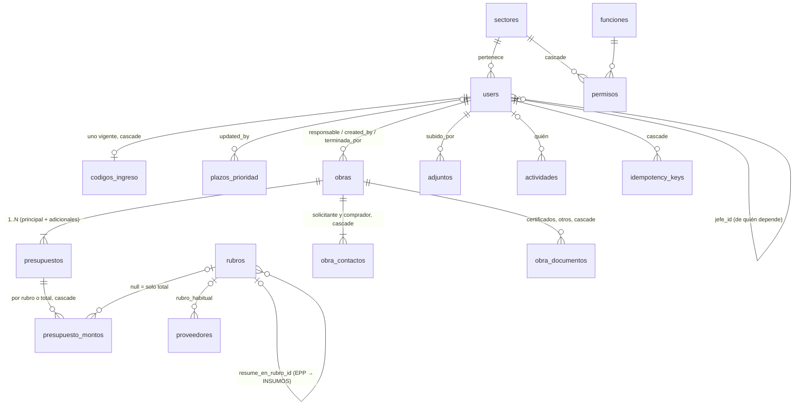
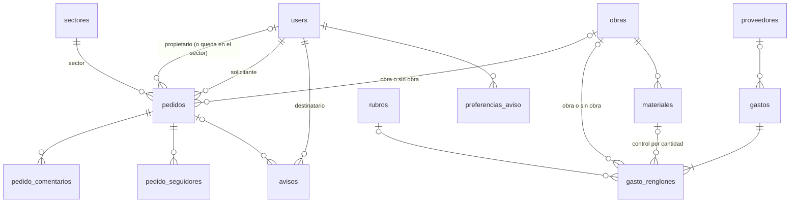

# Modelo de datos — Etapa 1

> Rol: DBA. Estado: **aprobado por Juani** (2026-11-12); **alineado al esquema real de `main`** al cierre
> de la semana 1 (2026-11-13, revisión Tech Lead / Seguridad). Fuente de verdad del esquema:
> `database/migrations/`. Lo que todavía no tiene migración figura como **Planificado** (semanas 2–3).
> Fuentes: documento firmado (cap. 6–11, tablas "Datos de…"), maquetas W-XX, ADR-004/006/007/008/010/011/012/014/015.
> Convenciones: tablas en español snake_case plural con `$table` explícito; PK `id` BIGINT;
> FK con `constrained()` y `restrictOnDelete` salvo donde se indica (MySQL crea el índice de cada FK);
> `timestamps` en todo lo editable; importes `DECIMAL(15,2)`, cantidades `DECIMAL(14,3)`; enums como
> `VARCHAR` + enum de PHP (cambiar un valor no exige `ALTER`). **No se borra nada que tenga historia**: se
> desactiva o se anula. Catálogos (rubros, funciones, configuración inicial de permisos y plazos,
> proveedor genérico) se cargan **por migración** idempotente, no por seeder. Las "únicas condicionales"
> (solo entre activos, uno por obra) se resuelven con **columnas generadas** + índice único (MySQL 8).

## 1. Diagrama

### 1.1 Esquema en `main` (migrado)



`adjuntos` y `actividades` son polimórficas (`sujeto_type`, `sujeto_id`) con alias estables
(`Relation::morphMap` en `ObrasServiceProvider`: `obra`, `presupuesto`, `obra_documento`).

### 1.2 Planificado (sin migración todavía)



`equipos_reparacion` no tiene relaciones de negocio fuertes y se describe abajo.

## 2. Diccionario por módulo

### Identidad (cap. 11, F-01, F-02, F-10, F-58…F-61, F-68) — migrado

**`sectores`** — sectores del organigrama (W-40). Migración `2026_11_13_100000`.
| Campo | Tipo | Nota |
|---|---|---|
| nombre | varchar(80) | "Compras", "Ingeniería de proyectos"… renombrable (F-59) |
| nombre_clave | varchar(80) | nombre normalizado (ASCII, minúsculas, espacios colapsados) |
| es_direccion | bool | Dirección ve todo (F-61) — se usa para la visibilidad, no para permisos |
| activo | bool | "Sacar un sector" = archivar si tiene historia; borrar solo si nunca se usó |
| nombre_clave_activo | varchar(80) GENERATED (`IF(activo, nombre_clave, NULL)`) | **único**: el nombre no se repite entre sectores activos; uno archivado libera el nombre |
| timestamps | | |

**`users`** — migraciones `0001_01_01_000000`, `2026_11_13_100001` y `2026_11_13_400000`.
| Campo | Tipo | Nota |
|---|---|---|
| nombre | varchar(120) | |
| email | varchar(190) único | mail de la empresa, en minúsculas; es el usuario de ingreso (ADR-015) |
| telefono | varchar(50), null | opcional (W-39, W-19) |
| sector_id | FK sectores | obligatorio |
| jefe_id | FK users, null | "de quién depende" (F-58); base de "mi gente" y del "superior" que recibe el aviso de completado |
| activo | bool, default true | inactivo no entra ni recibe código y pierde la sesión en el próximo pedido; no se borra (W-39) |
| remember_token, timestamps | | `remember_token` es de Laravel; no se usa (no hay "recordarme", ADR-015) |

**Sin contraseña** (ADR-015, 13-nov): la columna `password` se quitó en `2026_11_13_400000_ingreso_con_codigo_por_mail`
(su `down()` la vuelve a crear nullable, sin datos).

Índices: `email` (único), `(sector_id, activo)`, `sector_id` y `jefe_id` (FK). Regla: `jefe_id` no puede generar ciclos (validado en el caso de uso, `ReglasDeJefatura`).

**`codigos_ingreso`** — código de 6 dígitos para entrar (F-01, W-16, ADR-015). Migración `2026_11_13_400000`.
| Campo | Tipo | Nota |
|---|---|---|
| user_id | FK users **único**, cascade | un código vigente por persona: pedir otro lo reemplaza |
| codigo_hash | varchar(255) | HMAC-SHA256 del código con la `APP_KEY`; nunca el código en claro |
| intentos_fallidos | tinyint unsigned, default 0 | al 5.º fallo se borra la fila |
| vence_at | datetime | 10 minutos después de pedirlo (`datetime`: en MariaDB 10.4 un `timestamp` NOT NULL se pisa solo en cada UPDATE) |
| timestamps | | |

Usado, vencido o con 5 fallos: la fila se borra (`CodigosDeIngreso`).

**`funciones`** — filas de la tabla de permisos (catálogo por migración `2026_11_13_100005`; lista en `especificacion/identidad.md`). Sin timestamps.
| Campo | Tipo | Nota |
|---|---|---|
| clave | varchar(40) único | `pedidos`, `obras`, `rendicion`, `monto_obra`… |
| nombre | varchar(80) | como se ve en W-15 |
| admite_editar | bool | hoy `true` en las 12 funciones (incluida `monto_obra`, DU-A21) |
| admite_alcance | bool | si acepta "solo sus obras" (ADR-006): `pedidos`, `obras`, `presupuesto_rubro`, `monto_obra`, `gastos`, `rendicion`, `control_cantidad` |
| orden | smallint unsigned | |

**`permisos`** — la matriz (F-60). Migración `2026_11_13_100002`.
| Campo | Tipo | Nota |
|---|---|---|
| sector_id | FK sectores, cascade | |
| funcion_id | FK funciones | |
| nivel | varchar(12) | `sin_acceso` · `ver` · `editar` |
| alcance | varchar(10) | `todas` · `propias` |
| timestamps | | |

Único `(sector_id, funcion_id)`. La migración `2026_11_13_100005` carga las 12 funciones, los 11 sectores
del organigrama (Dirección, Calidad, Gerencia de Operaciones, Jefatura de Proyectos, Ingeniería de proyectos,
Seguridad e Higiene, Gerencia de Administración, Jefatura de Administración, Compras, RRHH, Pañol y Logística)
y la configuración inicial del cap. 3, con `insertOrIgnore` (idempotente; no pisa cambios hechos desde W-15).
Un sector nuevo nace con Pedidos y Equipos en reparación `editar` y Obras `ver` ("todos pueden pedir"),
el resto `sin_acceso` (DU-A06; lo hace `CrearSectorAction`).

**`plazos_prioridad`** — F-68, W-50. **Una sola fila** (cargada por la migración `2026_11_13_100003`).
| Campo | Tipo | Nota |
|---|---|---|
| urgente_hasta_dias | smallint unsigned | inicial 1 |
| prioritario_hasta_dias | smallint unsigned | inicial 7; mayor que `urgente_hasta_dias`; más que eso = `normal` (se deriva) |
| updated_by | FK users, null, `nullOnDelete` | |
| timestamps | | |

La prioridad calculada se **guarda** en el pedido al crearlo o al cambiar la entrega: cambiar plazos no recalcula lo cargado (W-50).

### Obras (cap. 6, F-15…F-23) — migrado

**`obras`** — migración `2026_11_13_200001`.
| Campo | Tipo | Oblig. | Nota |
|---|---|---|---|
| nombre_trabajo | varchar(200) | sí | |
| cliente | varchar(150) | sí | texto: el cliente es un dato de la obra (D-026); no hay maestro de clientes en la Etapa 1 |
| planta | varchar(150) | no | cuando trabajan como subcontratistas dentro de otra empresa |
| responsable_id | FK users | sí | responsable de obra; base del alcance "solo sus obras" |
| estado | varchar(15), default `confirmada` | sí | `confirmada` (inicial) · `en_ejecucion` · `terminada` |
| fecha_inicio_prevista, fecha_fin_prevista | date | no | F-23 |
| carpeta_drive_url | varchar(500) | no | link a la carpeta de la obra (solo http/https; una carpeta no se sube, ADR-014) |
| terminada_at | timestamp | no | se completa al pasar a Terminada y se limpia al volver a En ejecución |
| terminada_por | FK users | no | |
| created_by | FK users | sí | |
| timestamps | | | |

Índices: `estado`, `cliente`, y los de FK (`responsable_id`, `terminada_por`, `created_by`). Buscador (F-03):
`numero` de cualquier presupuesto (también "compacto", sin separadores), `cliente`, `nombre_trabajo`, `planta`
con `LIKE` parametrizado y comodines escapados (`PorBusqueda`; volumen chico, FULLTEXT si hiciera falta).

**`presupuestos`** — 1..N por obra (F-18, W-21). El principal da el "N.º de presupuesto y revisión" de la obra. Migración `2026_11_13_200002`.
| Campo | Tipo | Oblig. | Nota |
|---|---|---|---|
| obra_id | FK obras | sí | |
| numero | varchar(30) **único** | sí | normalizado por `NumeroPresupuesto` ("2-105-2026"); único en todas las obras y **sin** la revisión (DU-A16) |
| revision | varchar(10) | no | "REV01"; obligatoria en el principal (regla del caso de uso) |
| es_principal | bool, default false | sí | |
| principal_de | bigint GENERATED (`IF(es_principal, obra_id, NULL)`) **único** | — | a lo sumo un principal por obra |
| descripcion | varchar(200) | no | p. ej. "Adicional A1 — reparación de juntas" |
| aprobacion_tipo | varchar(20) | no | `oc` · `ot` · `contrato` · `mail` |
| aprobacion_numero | varchar(60) | no | N.º de OC/OT |
| modo_carga | varchar(12), default `sin_cargar` | sí | `sin_cargar` · `por_rubro` · `solo_total` (W-13) |
| monto_obra | decimal(15,2) | no | monto asignado del presupuesto; lo ve y lo edita quien tiene `monto_obra` (se omite del JSON sin permiso) |
| created_by | FK users | sí | W-20 "Cargado: fecha · persona" |
| timestamps | | | |

La oferta técnica (obligatoria) y la OC/OT/contrato/mail van como **archivo o link** en `adjuntos` (contextos
`presupuesto` y `aprobacion`, ADR-014). La OC no siempre llega (D-027).

**Desvío decidido (semana 1):** `modo_carga` **se guarda** como columna (la propuesta original lo derivaba de
`presupuesto_montos`). Motivo: distinguir "solo total en 0" de "sin cargar" y registrar el cambio de modo en el
historial (W-13). `CargarMontosAction` lo mantiene coherente con las filas de `presupuesto_montos` en la misma transacción.

**`obra_contactos`** — migración `2026_11_13_200003`.
| Campo | Tipo | Nota |
|---|---|---|
| obra_id | FK obras, cascade | |
| tipo | varchar(12) | `solicitante` · `comprador` |
| nombre | varchar(120) | obligatorio |
| email | varchar(190) | obligatorio |
| telefono | varchar(50) | obligatorio |
| timestamps | | |

Único `(obra_id, tipo)`: uno de cada tipo, obligatorios al dar de alta (cap. 6).

**`obra_documentos`** — migración `2026_11_13_200003`.
| Campo | Tipo | Nota |
|---|---|---|
| obra_id | FK obras, cascade | |
| tipo | varchar(12) | `certificado` · `otro` |
| nombre | varchar(120) | |
| fecha | date, null | obligatoria en `certificado` (regla del caso de uso, W-20) |
| created_by | FK users | |
| timestamps | | |

Índice `(obra_id, tipo)`. El archivo o link va en `adjuntos` (contexto `documento_obra`, ADR-014).

**`presupuesto_montos`** — lo presupuestado (F-48, W-13). Migración `2026_11_14_200001`. **Dueño: Obras**
(desvío decidido: la arquitectura lo ponía en Rendicion; lo escribe `CargarMontosAction` y Rendicion lo
leerá por el contrato `ObrasConsulta::presupuestadoPorRubro`).
| Campo | Tipo | Nota |
|---|---|---|
| presupuesto_id | FK presupuestos, cascade | |
| rubro_id | FK rubros, **null** | null = el presupuesto solo tiene el total (C16) |
| monto | decimal(15,2) | ≥ 0, máximo 2 decimales (validado en el borde, `ImporteValido`) |
| rubro_clave | bigint unsigned GENERATED (`COALESCE(rubro_id, 0)`) | para el único |
| timestamps | | |

Único `(presupuesto_id, rubro_clave)`. Regla del caso de uso: un presupuesto se carga **o** por rubro **o** con un total, no mezclado.

### Rendición (cap. 9, F-48…F-54, F-66)

**`rubros`** — lista cerrada (catálogo por migración `2026_11_13_300001`; modelo en `app/Modules/Rendicion/Domain/Models/Rubro.php`,
lo leen Obras y Proveedores por FK). Sin timestamps. — migrado
| Campo | Tipo | Nota |
|---|---|---|
| clave | varchar(40) único | identificador estable que usa la API: `materiales`, `insumos`, `epp`, `subcontratos`, `logistica`, `amortizacion`, `mantenimiento`, `obradores_banos`, `servicios_generales`, `maquinas_herramientas`, `viaticos`, `fijos`, `horas_liquidadas` |
| nombre | varchar(40) único | escrito como en sus planillas: MATERIALES, INSUMOS, EPP, SUBCONTRATOS, LOGISTICA, AMORTIZACION, MANTENIMIENTO, OBRADORES/BAÑOS, SERVICIOS GENERALES, MAQUINAS/HERRAMIENTAS, VIATICOS, FIJOS, HORAS LIQUIDADAS |
| orden | smallint unsigned | el de su hoja "General" |
| resume_en_rubro_id | FK rubros, null | EPP → INSUMOS en el resumen |
| se_presupuesta | bool | EPP = false (se presupuesta dentro de INSUMOS) |
| carga_por_periodo | bool | FIJOS y HORAS LIQUIDADAS: monto total por período |

La migración crea la tabla solo si no existe (la compartían Obras y Proveedores en ramas paralelas) y carga
las 13 filas con `insertOrIgnore`.

**`materiales`** — control por cantidad (F-66, W-48). **Planificado** (semana 3).
| Campo | Tipo | Nota |
|---|---|---|
| obra_id | FK obras | |
| presupuesto_id | FK presupuestos, null | de qué presupuesto sale |
| nombre | varchar(150) | |
| unidad | varchar(20) | |
| cantidad_presupuestada | decimal(14,3), null | null en "fuera de presupuesto" |
| precio_presupuestado | decimal(15,2), null | |
| fuera_de_presupuesto | bool | sección aparte en W-48 |

**Lo retirado no se guarda acá**: es la suma de `gasto_renglones.cantidad` con ese `material_id` (ADR-007). "Resta llevar" = presupuestada − retirada.

### Gastos (cap. 8, F-39…F-47) — Planificado (semana 2–3)

**`gastos`** — cabecera (una factura o un gasto, cargado una vez).
| Campo | Tipo | Oblig. | Nota |
|---|---|---|---|
| tipo_documento | varchar(15) | sí | `factura` · `sin_documento` (W-10) |
| origen | varchar(20) | sí | desde qué carga vino: `factura`, `sin_comprobante` (W-35), `combustible`, `consumo_stock`, `amortizacion`, `retiro_remito`, `devolucion` (W-46), `monto_periodo` (horas/fijos), `saldo_inicial` (F-62). Sirve para filtros y reglas; no se edita |
| numero | varchar(40) | factura sí | N.º de factura o de remito |
| fecha | date | sí | |
| proveedor_id | FK proveedores | factura sí | sin documento: proveedor genérico (F-44) |
| rendido_por | varchar(120) | no | gastos sin comprobante (C12). Texto: quien rinde puede no ser usuario (supervisión no usa el sistema) |
| periodo_desde, periodo_hasta | date | `monto_periodo` sí | horas y fijos (C18) |
| observaciones | text | no | factura escaneada o tickets: archivo o link en `adjuntos` (`comprobante_gasto`; remito: `remito`) |
| cargado_por | FK users | sí | quién y cuándo (F-46) |
| anulado_at, anulado_por, motivo_anulacion | | no | anular en lugar de borrar (W-34) |

Índices: `(proveedor_id, fecha)`, `numero`, `fecha`, `anulado_at`. Único parcial anti-duplicado: `(proveedor_id, tipo_documento, numero)` para facturas no anuladas, vía columna generada `numero_vigente` (null si anulada o sin documento) — una factura no se carga dos veces (criterio de aceptación 2).

**`gasto_renglones`** — **la única fuente del gastado** (ADR-007).
| Campo | Tipo | Oblig. | Nota |
|---|---|---|---|
| gasto_id | FK gastos, cascade | sí | |
| orden | smallint | sí | |
| concepto | varchar(250) | sí | el detalle |
| cantidad | decimal(14,3) | sí | negativa solo si `origen = devolucion` |
| precio_unitario | decimal(15,2) | sí | neto, con bonificación aplicada (C9) |
| total | decimal(15,2) | sí | `round(cantidad × precio_unitario, 2)`, lo calcula el backend |
| obra_id | FK obras, null | — | null = "sin obra" (stock, vehículos, oficina) |
| rubro_id | FK rubros, null | si hay obra | CHECK: `obra_id IS NULL OR rubro_id IS NOT NULL` |
| material_id | FK materiales, null | no | liga el renglón al control por cantidad |
| detalle | varchar(250) | no | cotización de la moneda extranjera, aclaraciones |

Índices: `(obra_id, rubro_id)` (rendición), `rubro_id`, `material_id`, `gasto_id`.

### Proveedores (cap. 10, F-55…F-57) — migrado

**`proveedores`** — migraciones `2026_11_13_300002` y `2026_11_13_300003` (proveedor genérico).
| Campo | Tipo | Oblig. | Nota |
|---|---|---|---|
| nombre | varchar(150) | sí | como se escribió (espacios colapsados) |
| nombre_clave | varchar(150) **único** | sí | normalización suave (minúsculas, sin tildes ni puntuación, sin forma societaria al final): impide el mismo nombre dos veces (RN-PRV-04, DU-10) |
| nombre_normalizado | varchar(150), índice | sí | normalización fuerte (además sin artículos ni "y"): base del "aviso de parecidos" (W-38), no bloquea |
| nombre_busqueda | varchar(150), índice | sí | minúsculas, sin tildes ni puntuación (con la forma societaria): lo recorre el buscador y ordena la lista (RN-PRV-02/03) |
| cuit | **char(11)**, null, **único** | no | solo los 11 dígitos, con dígito verificador válido (`Domain\Cuit`); se muestra con guiones |
| telefono | varchar(50) | no | contacto |
| email | varchar(190) | no | en minúsculas |
| rubro_habitual_id | FK rubros, null | no | sugiere el rubro al cargar renglones |
| es_generico | bool, default false | | el proveedor genérico de los gastos sin comprobante ("Gastos sin comprobante", por migración); no se edita |
| generico_unico | tinyint GENERATED (`IF(es_generico, 1, NULL)`) **único** | — | a lo sumo un genérico |
| activo | bool, default true | | no hay baja de proveedores en la Etapa 1 |
| created_by, updated_by | FK users, null | | quién cargó y quién editó (F-56) |
| timestamps | | | |

Sin saldos ni cuenta corriente (siguen en Tango).

### Pedidos (cap. 7, F-24…F-38, F-65, F-67) — Planificado (semana 2)

**`pedidos`**
| Campo | Tipo | Oblig. | Nota |
|---|---|---|---|
| obra_id | FK obras, null | no | null = pedido sin obra (W-25) |
| tarea | text | sí | texto libre |
| sector_id | FK sectores | sí | el pedido "queda en su sector" |
| propietario_id | FK users, null | no | null = asignado al sector (F-32) |
| solicitante_id | FK users | sí | quien lo carga (automático) |
| con_quien | varchar(150) | no | la columna PROVEEDOR de su minuta: texto libre (no es el maestro de proveedores) |
| fecha_pedido | date | sí | hoy por defecto, corregible (F-25) |
| fecha_entrega | date | ver dudas | |
| periodo_inicio, periodo_fin | date | no | lo que dura (alojamiento, alquiler) |
| aclaraciones | text | no | |
| prioridad | varchar(12) | sí | `urgente` · `prioritario` · `normal` |
| prioridad_manual | bool | | true si quien cargó la corrigió (F-26) |
| estado | varchar(12) | sí | `no_iniciada` · `en_curso` · `bloqueada` · `completada` |
| motivo_bloqueo | text | si bloqueada | |
| completado_at, completado_por | | si completada | |
| comentario_cierre | text | si completada | obligatorio (D-030) |

Índices: `(propietario_id, estado, fecha_entrega)` (Mis tareas), `(solicitante_id, estado)`, `(obra_id, estado)`, `(sector_id, estado)`, `(estado, fecha_entrega)` (recordatorio y vencidos). FULLTEXT en `tarea` para el buscador.

Archivos y links del pedido (F-27) y comprobante de cierre: en `adjuntos` (contextos `pedido` y `comprobante_cierre`, ADR-014).
**`pedido_comentarios`** — `pedido_id` (cascade), `user_id`, `texto`, `created_at`. Solo inserción (F-30).
**`pedido_seguidores`** — `pedido_id`, `user_id`, único par (F-07).

**`equipos_reparacion`** — F-67, W-49.
| Campo | Tipo | Nota |
|---|---|---|
| codigo | varchar(40) | código interno del equipo (enlazará con Herramientas en la etapa siguiente) |
| equipo | varchar(150) | |
| trabajo | text | falla o trabajo |
| taller | varchar(150) | texto (como hoy) |
| estado | varchar(12) | `no_iniciada` · `para_retiro` · `en_curso` · `bloqueada` · `completada` |
| aprobacion | varchar(12) | `pendiente` · `aprobado` · `bloqueado` (se registra; el sistema no decide) |
| fecha | date, null | |
| notas | text, null | presupuesto e inventario: archivo o link en `adjuntos` (ADR-014) |
| created_by, updated_by | FK users | |

### Avisos (F-08, F-09, F-37, F-64) — Planificado (semana 2)

**`avisos`**
| Campo | Tipo | Nota |
|---|---|---|
| user_id | FK users | destinatario |
| tipo | varchar(30) | `asignado`, `reasignado`, `tomado`, `bloqueado`, `comentado`, `completado`, `completado_gente`, `reabierto`, `vence_manana` |
| pedido_id | FK pedidos, null | |
| actor_id | FK users, null | quién lo provocó |
| datos | json | resumen para mostrar sin otra consulta (tarea, obra, comentario) |
| dedupe_key | varchar(120), único, null | idempotencia (ADR-011/012) |
| leido_at | timestamp, null | |
| created_at | timestamp | |

Índice `(user_id, leido_at, created_at)`.

**`preferencias_aviso`** — `user_id`, `tipo`, `por_mail` bool. Único `(user_id, tipo)`. Sin fila = valor por defecto (mail solo en `asignado` y `reasignado`).

### Transversales (`app/Shared`) — migrado

**`actividades`** — ADR-010. Migración `2026_11_13_100000`. Solo inserción.
| Campo | Tipo | Nota |
|---|---|---|
| sujeto_type | varchar(120) | alias del morph map (`obra`, `presupuesto`, `obra_documento`…) |
| sujeto_id | bigint unsigned | |
| user_id | FK users, null | quién (null = sistema) |
| accion | varchar(40) | `creado`, `editado`, `estado_cambiado`, `adjunto_agregado`, `adjunto_quitado`… |
| cambios | json, null | `{campo: {antes, despues}}`; los adjuntos se registran por nombre, sin URL ni ruta |
| created_at | timestamp, default actual | |

Índice `(sujeto_type, sujeto_id, created_at)`.

**`adjuntos`** — ADR-014. Migración `2026_11_13_100200`. Un archivo **o** un link.
| Campo | Tipo | Nota |
|---|---|---|
| sujeto_type, sujeto_id | varchar(120) / bigint, null | null hasta que el caso de uso lo asocia (se purga a las 24 h, `adjuntos:purgar-huerfanos`) |
| contexto | varchar(30) | registrados hoy: `presupuesto`, `aprobacion`, `documento_obra` (Obras). Planificados: `pedido`, `comprobante_cierre`, `comprobante_gasto`, `remito`, `equipo_presupuesto`, `equipo_inventario` |
| tipo | varchar(8) | `archivo` · `link` |
| url | varchar(1000), null | si es link (solo http/https) |
| disco | varchar(40), null | si es archivo (`ADJUNTOS_DISK`, por defecto `adjuntos`, privado) |
| ruta | varchar(255), null | si es archivo: `adjuntos/AAAA/MM/<uuid>`, sin extensión; nunca sale en el JSON |
| nombre | varchar(200) | nombre original saneado o etiqueta del link (por defecto, el dominio) |
| mime | varchar(100), null | MIME detectado por contenido |
| tamano_bytes | int unsigned, null | |
| subido_por | FK users | |
| created_at | timestamp, default actual | |

CHECK `adjuntos_archivo_o_link`: `(tipo = 'link' AND url IS NOT NULL AND ruta IS NULL) OR (tipo = 'archivo' AND ruta IS NOT NULL AND url IS NULL)`. Índice `(sujeto_type, sujeto_id, contexto)`.

**`idempotency_keys`** — ADR-011. Migración `2026_11_13_100100`.
| Campo | Tipo | Nota |
|---|---|---|
| user_id | FK users, cascade | |
| clave | uuid (char 36) | la `Idempotency-Key`, en minúsculas |
| ruta | varchar(255) | `MÉTODO path`; otra ruta con la misma clave → 422 |
| payload_hash | char(64) | SHA-256 del cuerpo normalizado (y de los archivos); otro payload → 422 |
| status | varchar(12) | `en_curso` · `completada` (un `en_curso` de más de 60 s se considera abandonado) |
| respuesta | json, null | `{status, content_type, body}`; solo se guardan respuestas 2xx |
| timestamps | | |

Único `(user_id, clave)`; índice `created_at`. Se purgan a las 24 h (`idempotencia:purgar`, programado).

Además las tablas de Laravel: `cache`, `cache_locks`, `jobs`, `job_batches`, `failed_jobs`, `sessions` (creada por
el esqueleto; la sesión va a Redis) y `personal_access_tokens` (Sanctum; sin uso, la SPA entra por cookie).
`password_reset_tokens` y `password_bienvenida_tokens` se crean en migraciones previas y se eliminan en
`2026_11_13_400000` (ADR-015).

## 3. Consultas críticas

**Rendición de una obra (F-49, W-11)** — dos agregados, sin N+1:

```sql
-- presupuestado por rubro (suma de todos los presupuestos de la obra)
SELECT pm.rubro_id, SUM(pm.monto) presupuestado
FROM presupuesto_montos pm JOIN presupuestos p ON p.id = pm.presupuesto_id
WHERE p.obra_id = ? GROUP BY pm.rubro_id;

-- gastado por rubro (sin anulados)
SELECT r.rubro_id, SUM(r.total) gastado
FROM gasto_renglones r JOIN gastos g ON g.id = r.gasto_id
WHERE r.obra_id = ? AND g.anulado_at IS NULL GROUP BY r.rubro_id;
```

El resumen aplica `resume_en_rubro_id` (EPP → INSUMOS) en PHP sobre 13 filas. Si la obra solo
tiene totales (`rubro_id` null en presupuesto), se compara el total contra la suma de todo lo
gastado. Usa el índice `(obra_id, rubro_id)`; EXPLAIN se adjunta al implementar (semana 3).
El presupuestado ya está implementado en `ObrasConsultaEloquent::presupuestadoPorRubro` (contrato `ObrasConsulta`, devuelve `PresupuestadoDeObra`).

**Todas las rendiciones (F-53, W-12)** — las mismas dos consultas agrupadas por `obra_id`
para las obras `en_ejecucion` (una consulta por agregado, no por obra).

**Listado de obras (F-15)** — `pedidos abiertos` y `% gastado` salen de los puertos `PedidosDeObra` y
`AvanceGastoDeObra` con una consulta por página (hoy implementaciones nulas hasta semanas 2–3); el test
`test_listado_no_hace_una_consulta_por_obra` lo vigila.

**Mis tareas (F-04)** — `pedidos WHERE propietario_id = ? AND estado <> 'completada' ORDER BY fecha_entrega` sobre su índice compuesto.

**Mi gente (F-06, F-12)** — CTE recursivo sobre `users.jefe_id` para obtener los subordinados (`JerarquiaPorJefe`), y un `WHERE propietario_id IN (...)`.

## 4. Lo que el modelo anticipa sin construirlo

| Etapa siguiente | Qué ya queda listo |
|---|---|
| Indicadores | Todo el gastado estará en `gasto_renglones` con fecha, obra y rubro; el presupuestado está en `presupuesto_montos` |
| Cotizaciones (costeo) | `presupuestos` tiene número y revisión: una cotización futura se liga por `presupuesto_id` |
| Herramientas | `equipos_reparacion.codigo` y el rubro AMORTIZACION; el submódulo se mueve sin migrar datos |
| Tango | `proveedores.cuit` (11 dígitos), `gastos.numero` y `tipo_documento` son las claves de cruce |

## 5. Migraciones

- Todas reversibles (`down` real). Nada de `DROP DATABASE` ni `migrate:fresh` fuera de la base de tests.
- Catálogos y configuración inicial en migraciones de datos idempotentes (`insertOrIgnore` / "si no existe").
- Seeders solo para datos **ficticios** de desarrollo y demo (nada de nombres, proveedores ni importes reales).
- Orden en `main` (semana 1): esqueleto Laravel (`0001_*`) → Sanctum → Identidad y Shared (`2026_11_13_1000xx`, `1001xx`, `1002xx`)
  → Obras (`2026_11_13_2000xx`) → `rubros` y Proveedores (`2026_11_13_3000xx`) → ingreso con código (`2026_11_13_400000`)
  → `presupuesto_montos` (`2026_11_14_200001`, después de `rubros`).

### Desvíos respecto de la propuesta del Sprint 0 (todos decididos en semana 1)

| Tabla | Propuesta original | Esquema real | Motivo |
|---|---|---|---|
| `users` | con `password` | sin `password`; `nombre`, `telefono`, `activo` | ADR-015 (código por mail) |
| `codigos_ingreso` | — | nueva | ADR-015 |
| `sectores` | `nombre` único | único **entre activos** (`nombre_clave_activo` generada) | un sector archivado libera el nombre |
| `funciones` | `admite_editar` false en filas que solo se miran | `true` en las 12 | configuración del cap. 3 |
| `plazos_prioridad` | — | una sola fila por migración | W-50 |
| `presupuestos` | modo de carga derivado | columna `modo_carga` | historial y "solo total en 0" vs "sin cargar" |
| `presupuesto_montos` | dueño Rendicion | dueño **Obras** | lo carga W-13 dentro de la obra |
| `rubros` | sin `clave` | `clave` estable; modelo en Rendicion | la API usa claves, no nombres con "/" y "Ñ" |
| `proveedores` | `cuit varchar(13)` | `cuit char(11)` (solo dígitos); `nombre_busqueda`; `generico_unico`; `created_by`/`updated_by` | buscador sin tildes ni puntuación; un solo genérico; quién y cuándo |
| `actividades`, `idempotency_keys`, `adjuntos` | descritas en una línea | columnas detalladas arriba | implementación de ADR-010/011/014 |
