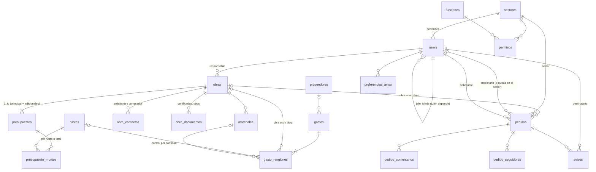

# Modelo de datos — Etapa 1

> Rol: DBA. Estado: **Propuesta para aprobar por Juani** (Sprint 0, 2026-11-12).
> Fuentes: documento firmado (cap. 6–11, tablas "Datos de…"), maquetas W-XX, ADR-004/006/007/008/010/011/012.
> Convenciones: tablas en español snake_case plural con `$table` explícito; PK `id` BIGINT;
> FK con `constrained()` y `restrictOnDelete` salvo donde se indica; `timestamps` en todo lo
> editable; importes `DECIMAL(15,2)`, cantidades `DECIMAL(14,3)`; enums como `VARCHAR` +
> enum de PHP (cambiar un valor no exige `ALTER`). **No se borra nada que tenga historia**: se
> desactiva o se anula. Catálogos (rubros, funciones, configuración inicial de permisos y
> plazos) se cargan **por migración**, no por seeder.

## 1. Diagrama



`actividades` (auditoría polimórfica), `idempotency_keys`, `plazos_prioridad` y
`equipos_reparacion` no tienen relaciones de negocio fuertes y se describen abajo.

## 2. Diccionario por módulo

### Identidad (cap. 11, F-01, F-02, F-10, F-58…F-61, F-68)

**`sectores`** — sectores del organigrama (W-40).
| Campo | Tipo | Nota |
|---|---|---|
| nombre | varchar(80) único | "Compras", "Ingeniería de proyectos"… renombrable (F-59) |
| es_direccion | bool | Dirección ve todo (F-61) — se usa para la visibilidad, no para permisos |
| activo | bool | "Sacar un sector" = desactivar si tiene historia; borrar solo si nunca se usó |

**`users`**
| Campo | Tipo | Nota |
|---|---|---|
| nombre | varchar(120) | |
| email | varchar(190) único | mail de la empresa; es el usuario de ingreso (ADR-009) |
| password | varchar | hash |
| sector_id | FK sectores | obligatorio |
| jefe_id | FK users, null | "de quién depende" (F-58); base de "mi gente" y del "superior" que recibe el aviso de completado |
| activo | bool | inactivo no entra; no se borra (W-39) |
| remember_token, timestamps | | |

Índices: `email`, `(sector_id, activo)`, `jefe_id`. Regla: `jefe_id` no puede generar ciclos (validado en el caso de uso).

**`funciones`** — filas de la tabla de permisos (catálogo por migración; lista final en `especificacion/identidad.md`).
| Campo | Tipo | Nota |
|---|---|---|
| clave | varchar(40) único | `pedidos`, `obras`, `rendicion`, `monto_obra`… |
| nombre | varchar(80) | como se ve en W-15 |
| admite_editar | bool | false en filas que solo se miran; true en `monto_obra` (DU-A21) |
| admite_alcance | bool | si acepta "solo sus obras" (ADR-006) |
| orden | smallint | |

**`permisos`** — la matriz (F-60).
| Campo | Tipo | Nota |
|---|---|---|
| sector_id | FK sectores, cascade | |
| funcion_id | FK funciones | |
| nivel | varchar(12) | `sin_acceso` · `ver` · `editar` |
| alcance | varchar(10) | `todas` · `propias` |

Único `(sector_id, funcion_id)`. Un sector nuevo aparece como una fila más (W-40) y nace con Pedidos y Equipos en reparación `editar` y Obras `ver` ("todos pueden pedir"), el resto `sin_acceso` (DU-A06, resuelta). Catálogo: las 12 funciones de `especificacion/identidad.md`; `monto_obra` admite editar (lo carga administración).

**`plazos_prioridad`** — F-68, W-50.
| Campo | Tipo | Nota |
|---|---|---|
| prioridad | varchar(12) único | `urgente`, `prioritario` |
| hasta_dias | smallint | inicial: urgente 1, prioritario 7; más que eso = `normal` |
| updated_by | FK users, null | |

La prioridad calculada se **guarda** en el pedido al crearlo o al cambiar la entrega: cambiar plazos no recalcula lo cargado (W-50).

### Obras (cap. 6, F-15…F-23)

**`obras`**
| Campo | Tipo | Oblig. | Nota |
|---|---|---|---|
| nombre_trabajo | varchar(200) | sí | |
| cliente | varchar(150) | sí | texto: el cliente es un dato de la obra (D-026); no hay maestro de clientes en la Etapa 1 |
| planta | varchar(150) | no | cuando trabajan como subcontratistas dentro de otra empresa |
| responsable_id | FK users | sí | responsable de obra |
| estado | varchar(15) | sí | `confirmada` (inicial) · `en_ejecucion` · `terminada` |
| fecha_inicio_prevista, fecha_fin_prevista | date | no | F-23 |
| carpeta_drive_url | varchar(500) | no | link a la carpeta de la obra |
| created_by | FK users | | |

Índices: `estado`, `responsable_id`, `cliente`. Buscador (F-03): `numero` del presupuesto, `cliente`, `nombre_trabajo`, `planta` con `LIKE` (volumen chico; FULLTEXT si hiciera falta).

**`presupuestos`** — 1..N por obra (F-18, W-21). El principal da el "N.º de presupuesto y revisión" de la obra.
| Campo | Tipo | Oblig. | Nota |
|---|---|---|---|
| obra_id | FK obras | sí | |
| numero | varchar(30) | sí | normalizado por `NumeroPresupuesto` ("2-105-2026") |
| revision | varchar(10) | no | "REV01" |
| es_principal | bool | sí | exactamente uno por obra |
| descripcion | varchar(200) | no | p. ej. "Adicional A1 — reparación de juntas" |
| aprobacion_tipo | varchar(20) | no | `oc` · `ot` · `contrato` · `mail` |
| aprobacion_numero | varchar(60) | no | N.º de OC/OT |

La oferta técnica (obligatoria) y la OC/OT/contrato/mail van como **archivo o link** en `adjuntos` (contextos `presupuesto` y `aprobacion`, ADR-014). La OC no siempre llega (D-027).

| monto_obra | decimal(15,2) | no | monto asignado del presupuesto; lo ve y lo edita quien tiene `monto_obra` |
| created_by | FK users | sí | W-20 "Cargado: fecha · persona" |

Único `numero` (normalizado, **sin** la revisión: la revisión se edita sobre el mismo presupuesto, DU-A16). Índice `obra_id`.
El "modo de carga" (sin cargar · por rubro · solo total) **no se guarda**: se deriva de sus filas en `presupuesto_montos` (ninguna · con rubro · una con rubro null), así no hay dos verdades.

**`obra_contactos`** — `obra_id` (cascade), `tipo` (`solicitante`|`comprador`), `nombre`, `email`, `telefono`. Uno de cada tipo obligatorio al dar de alta (cap. 6). Único `(obra_id, tipo)`.

**`obra_documentos`** — `obra_id` (cascade), `tipo` (`certificado`|`otro`), `nombre`, `fecha` (date, null; W-20), `created_by`. El archivo o link va en `adjuntos` (contexto `documento_obra`, ADR-014).

En `obras` además: `terminada_at`, `terminada_por` (FK users, null) — se completan al pasar a Terminada.

### Rendición (cap. 9, F-48…F-54, F-66)

**`rubros`** — lista cerrada (catálogo por migración).
| Campo | Tipo | Nota |
|---|---|---|
| nombre | varchar(40) único | escrito como en sus planillas: MATERIALES, INSUMOS, EPP, SUBCONTRATOS, LOGISTICA, AMORTIZACION, MANTENIMIENTO, OBRADORES/BAÑOS, SERVICIOS GENERALES, MAQUINAS/HERRAMIENTAS, VIATICOS, FIJOS, HORAS LIQUIDADAS |
| orden | smallint | el de su hoja "General" |
| resume_en_rubro_id | FK rubros, null | EPP → INSUMOS en el resumen |
| se_presupuesta | bool | EPP = false (se presupuesta dentro de INSUMOS) |
| carga_por_periodo | bool | FIJOS y HORAS LIQUIDADAS: monto total por período |

**`presupuesto_montos`** — lo presupuestado (F-48, W-13).
| Campo | Tipo | Nota |
|---|---|---|
| presupuesto_id | FK presupuestos, cascade | |
| rubro_id | FK rubros, **null** | null = el presupuesto solo tiene el total (C16) |
| monto | decimal(15,2) | ≥ 0 |
| rubro_clave | int GENERATED (`COALESCE(rubro_id,0)`) | para el único |

Único `(presupuesto_id, rubro_clave)`. Regla del caso de uso: un presupuesto se carga **o** por rubro **o** con un total, no mezclado.

**`materiales`** — control por cantidad (F-66, W-48).
| Campo | Tipo | Nota |
|---|---|---|
| obra_id | FK obras | |
| presupuesto_id | FK presupuestos, null | de qué presupuesto sale |
| nombre | varchar(150) | |
| unidad | varchar(20) | |
| cantidad_presupuestada | decimal(14,3), null | null en "fuera de presupuesto" |
| precio_presupuestado | decimal(15,2), null | |
| fuera_de_presupuesto | bool | sección aparte en W-48 |

**Lo retirado no se guarda acá**: es la suma de `gasto_renglones.cantidad` con ese `material_id` (ADR-007). "Resta llevar" = presupuestada − retirada.

### Gastos (cap. 8, F-39…F-47)

**`gastos`** — cabecera (una factura o un gasto, cargado una vez).
| Campo | Tipo | Oblig. | Nota |
|---|---|---|---|
| tipo_documento | varchar(15) | sí | `factura` · `sin_documento` (W-10) |
| origen | varchar(20) | sí | desde qué carga vino: `factura`, `sin_comprobante` (W-35), `combustible`, `consumo_stock`, `amortizacion`, `retiro_remito`, `devolucion` (W-46), `monto_periodo` (horas/fijos), `saldo_inicial` (F-62). Sirve para filtros y reglas; no se edita |
| numero | varchar(40) | factura sí | N.º de factura o de remito |
| fecha | date | sí | |
| proveedor_id | FK proveedores | factura sí | sin documento: proveedor genérico (F-44) |
| rendido_por | varchar(120) | no | gastos sin comprobante (C12). Texto: quien rinde puede no ser usuario (supervisión no usa el sistema) |
| periodo_desde, periodo_hasta | date | `monto_periodo` sí | horas y fijos (C18) |
| observaciones | text | no | factura escaneada o tickets: archivo o link en `adjuntos` (`comprobante_gasto`; remito: `remito`) |
| cargado_por | FK users | sí | quién y cuándo (F-46) |
| anulado_at, anulado_por, motivo_anulacion | | no | anular en lugar de borrar (W-34) |

Índices: `(proveedor_id, fecha)`, `numero`, `fecha`, `anulado_at`. Único parcial anti-duplicado: `(proveedor_id, tipo_documento, numero)` para facturas no anuladas, vía columna generada `numero_vigente` (null si anulada o sin documento) — una factura no se carga dos veces (criterio de aceptación 2).

**`gasto_renglones`** — **la única fuente del gastado** (ADR-007).
| Campo | Tipo | Oblig. | Nota |
|---|---|---|---|
| gasto_id | FK gastos, cascade | sí | |
| orden | smallint | sí | |
| concepto | varchar(250) | sí | el detalle |
| cantidad | decimal(14,3) | sí | negativa solo si `origen = devolucion` |
| precio_unitario | decimal(15,2) | sí | neto, con bonificación aplicada (C9) |
| total | decimal(15,2) | sí | `round(cantidad × precio_unitario, 2)`, lo calcula el backend |
| obra_id | FK obras, null | — | null = "sin obra" (stock, vehículos, oficina) |
| rubro_id | FK rubros, null | si hay obra | CHECK: `obra_id IS NULL OR rubro_id IS NOT NULL` |
| material_id | FK materiales, null | no | liga el renglón al control por cantidad |
| detalle | varchar(250) | no | cotización de la moneda extranjera, aclaraciones |

Índices: `(obra_id, rubro_id)` (rendición), `rubro_id`, `material_id`, `gasto_id`.

### Proveedores (cap. 10, F-55…F-57)

**`proveedores`**
| Campo | Tipo | Oblig. | Nota |
|---|---|---|---|
| nombre | varchar(150) | sí | |
| nombre_clave | varchar(150) único | sí | normalización suave (minúsculas, sin tildes, espacios colapsados): impide el mismo nombre dos veces (DU-10) |
| nombre_normalizado | varchar(150) | sí | normalización fuerte (además sin puntuación ni "SA/SRL"): base del "aviso de parecidos" (W-38), no bloquea |
| cuit | varchar(13) | no | único si está |
| telefono, email | | no | contacto |
| rubro_habitual_id | FK rubros, null | no | sugiere el rubro al cargar renglones |
| es_generico | bool | | el proveedor genérico de los gastos sin comprobante (uno, por migración) |
| activo | bool | | |

Sin saldos ni cuenta corriente (siguen en Tango).

### Pedidos (cap. 7, F-24…F-38, F-65, F-67)

**`pedidos`**
| Campo | Tipo | Oblig. | Nota |
|---|---|---|---|
| obra_id | FK obras, null | no | null = pedido sin obra (W-25) |
| tarea | text | sí | texto libre |
| sector_id | FK sectores | sí | el pedido "queda en su sector" |
| propietario_id | FK users, null | no | null = asignado al sector (F-32) |
| solicitante_id | FK users | sí | quien lo carga (automático) |
| con_quien | varchar(150) | no | la columna PROVEEDOR de su minuta: texto libre (no es el maestro de proveedores) |
| fecha_pedido | date | sí | hoy por defecto, corregible (F-25) |
| fecha_entrega | date | ver dudas | |
| periodo_inicio, periodo_fin | date | no | lo que dura (alojamiento, alquiler) |
| aclaraciones | text | no | |
| prioridad | varchar(12) | sí | `urgente` · `prioritario` · `normal` |
| prioridad_manual | bool | | true si quien cargó la corrigió (F-26) |
| estado | varchar(12) | sí | `no_iniciada` · `en_curso` · `bloqueada` · `completada` |
| motivo_bloqueo | text | si bloqueada | |
| completado_at, completado_por | | si completada | |
| comentario_cierre | text | si completada | obligatorio (D-030) |

Índices: `(propietario_id, estado, fecha_entrega)` (Mis tareas), `(solicitante_id, estado)`, `(obra_id, estado)`, `(sector_id, estado)`, `(estado, fecha_entrega)` (recordatorio y vencidos). FULLTEXT en `tarea` para el buscador.

Archivos y links del pedido (F-27) y comprobante de cierre: en `adjuntos` (contextos `pedido` y `comprobante_cierre`, ADR-014).
**`pedido_comentarios`** — `pedido_id` (cascade), `user_id`, `texto`, `created_at`. Solo inserción (F-30).
**`pedido_seguidores`** — `pedido_id`, `user_id`, único par (F-07).

**`equipos_reparacion`** — F-67, W-49.
| Campo | Tipo | Nota |
|---|---|---|
| codigo | varchar(40) | código interno del equipo (enlazará con Herramientas en la etapa siguiente) |
| equipo | varchar(150) | |
| trabajo | text | falla o trabajo |
| taller | varchar(150) | texto (como hoy) |
| estado | varchar(12) | `no_iniciada` · `para_retiro` · `en_curso` · `bloqueada` · `completada` |
| aprobacion | varchar(12) | `pendiente` · `aprobado` · `bloqueado` (se registra; el sistema no decide) |
| fecha | date, null | |
| notas | text, null | presupuesto e inventario: archivo o link en `adjuntos` (ADR-014) |
| created_by, updated_by | FK users | |

### Avisos (F-08, F-09, F-37, F-64)

**`avisos`**
| Campo | Tipo | Nota |
|---|---|---|
| user_id | FK users | destinatario |
| tipo | varchar(30) | `asignado`, `reasignado`, `tomado`, `bloqueado`, `comentado`, `completado`, `completado_gente`, `reabierto`, `vence_manana` |
| pedido_id | FK pedidos, null | |
| actor_id | FK users, null | quién lo provocó |
| datos | json | resumen para mostrar sin otra consulta (tarea, obra, comentario) |
| dedupe_key | varchar(120), único, null | idempotencia (ADR-011/012) |
| leido_at | timestamp, null | |
| created_at | timestamp | |

Índice `(user_id, leido_at, created_at)`.

**`preferencias_aviso`** — `user_id`, `tipo`, `por_mail` bool. Único `(user_id, tipo)`. Sin fila = valor por defecto (mail solo en `asignado` y `reasignado`).

### Transversales (`app/Shared`)

**`actividades`** — ADR-010. `sujeto_type`, `sujeto_id`, `user_id`, `accion`, `cambios` json, `created_at`. Índice `(sujeto_type, sujeto_id, created_at)`. Solo inserción.

**`adjuntos`** — ADR-014. Un archivo **o** un link.
| Campo | Tipo | Nota |
|---|---|---|
| sujeto_type, sujeto_id | morph, null | null hasta que el caso de uso lo asocia (se purga a las 24 h) |
| contexto | varchar(30) | `pedido`, `comprobante_cierre`, `presupuesto`, `aprobacion`, `documento_obra`, `comprobante_gasto`, `remito`, `equipo_presupuesto`, `equipo_inventario` |
| tipo | varchar(8) | `archivo` · `link` |
| url | varchar(1000), null | si es link (solo http/https) |
| disco, ruta | varchar, null | si es archivo; nombre UUID en disco privado |
| nombre | varchar(200) | nombre original del archivo o etiqueta del link |
| mime, tamano_bytes | varchar(100), int unsigned, null | MIME detectado por contenido |
| subido_por | FK users | |
| created_at | timestamp | |

CHECK: `(tipo = 'link' AND url IS NOT NULL AND ruta IS NULL) OR (tipo = 'archivo' AND ruta IS NOT NULL AND url IS NULL)`. Índice `(sujeto_type, sujeto_id, contexto)`.

**`idempotency_keys`** — ADR-011. `user_id`, `clave` uuid, `ruta`, `payload_hash`, `status`, `respuesta` json, `created_at`. Único `(user_id, clave)`. Se purgan a las 24 h (comando programado).

Además las tablas de Laravel: `password_reset_tokens`, `jobs`, `failed_jobs`, `job_batches` (sesión y cache en Redis).

## 3. Consultas críticas

**Rendición de una obra (F-49, W-11)** — dos agregados, sin N+1:

```sql
-- presupuestado por rubro (suma de todos los presupuestos de la obra)
SELECT pm.rubro_id, SUM(pm.monto) presupuestado
FROM presupuesto_montos pm JOIN presupuestos p ON p.id = pm.presupuesto_id
WHERE p.obra_id = ? GROUP BY pm.rubro_id;

-- gastado por rubro (sin anulados)
SELECT r.rubro_id, SUM(r.total) gastado
FROM gasto_renglones r JOIN gastos g ON g.id = r.gasto_id
WHERE r.obra_id = ? AND g.anulado_at IS NULL GROUP BY r.rubro_id;
```

El resumen aplica `resume_en_rubro_id` (EPP → INSUMOS) en PHP sobre 13 filas. Si la obra solo
tiene totales (`rubro_id` null en presupuesto), se compara el total contra la suma de todo lo
gastado. Usa el índice `(obra_id, rubro_id)`; EXPLAIN se adjunta al implementar (semana 3).

**Todas las rendiciones (F-53, W-12)** — las mismas dos consultas agrupadas por `obra_id`
para las obras `en_ejecucion` (una consulta por agregado, no por obra).

**Listado de obras (F-15)** — `pedidos abiertos` con `withCount` filtrado y `% gastado` con
`withSum` (subconsultas correlacionadas sobre índices): una consulta para toda la página.

**Mis tareas (F-04)** — `pedidos WHERE propietario_id = ? AND estado <> 'completada' ORDER BY fecha_entrega` sobre su índice compuesto.

**Mi gente (F-06, F-12)** — CTE recursivo sobre `users.jefe_id` para obtener los subordinados, y un `WHERE propietario_id IN (...)`.

## 4. Lo que el modelo anticipa sin construirlo

| Etapa siguiente | Qué ya queda listo |
|---|---|
| Indicadores | Todo el gastado está en `gasto_renglones` con fecha, obra y rubro; el presupuestado en `presupuesto_montos` |
| Cotizaciones (costeo) | `presupuestos` tiene número y revisión: una cotización futura se liga por `presupuesto_id` |
| Herramientas | `equipos_reparacion.codigo` y el rubro AMORTIZACION; el submódulo se mueve sin migrar datos |
| Tango | `proveedores.cuit`, `gastos.numero` y `tipo_documento` son las claves de cruce |

## 5. Migraciones

- Todas reversibles (`down` real). Nada de `DROP DATABASE` ni `migrate:fresh` fuera de la base de tests.
- Catálogos y configuración inicial en migraciones de datos idempotentes (`updateOrInsert` por clave).
- Seeders solo para datos **ficticios** de desarrollo y demo (nada de nombres, proveedores ni importes reales).
